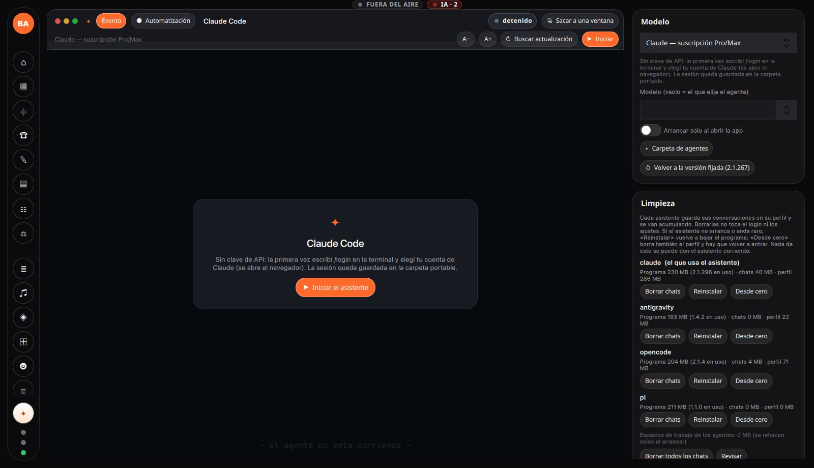

<p align="center">
  <picture>
    <source media="(prefers-color-scheme: dark)" srcset="assets/icons/logo.png">
    
  </picture>
</p>

**English** · [Español](README.es.md)

# Broadcast Appliance

An all-in-one live production studio — switcher, audio mixer, video conference,
assemblies, graphics, recording and streaming — that you run **by talking to an
AI assistant**. Portable: everything it needs travels inside the folder, on
Windows, macOS and Linux.

<p align="center">
  <a href="#"></a>
  <a href="https://github.com/blairq/broadcast-appliance/releases/latest"></a>
  <a href="https://github.com/blairq/broadcast-appliance/releases"></a>
  <a href="#license"></a>
  <br>
  
  
  
  
  
  
  
  
  
  
  
  <a href="https://github.com/blairq/broadcast-appliance/actions/workflows/ci.yml"></a>
</p>

> [!WARNING]
> **Beta.** Under active development: it changes from one release to the next and
> has not been tested with every device and room yet (for example, the Bosch DCN
> central unit). Before an important event, try it in a rehearsal with the same
> equipment.

---

## Quick start

1. **Download** the latest release for your system from
   **[Releases](https://github.com/blairq/broadcast-appliance/releases/latest)**:
   `.zip` for Windows, `.tar.gz` for Linux, `.dmg` for macOS.
2. **Unpack it and open `BroadcastAppliance`.** Nothing gets installed on the
   system: the program, its data and its models live in that folder.
   On macOS the app is not notarized: the first time, right-click it → **Open**.
3. **Set up the assistant.** On the **Asistente** page (✦ in the side menu),
   pick the agent and the model, and start it. Then the **Agentes** page lets
   you turn on the automatic roles you want. (The interface is in Spanish; the
   assistant answers in your language.)
4. **Ask it for everything.** «Set up an event for tomorrow at 7 pm with two
   cameras and a remote guest», «stream it to YouTube», «why does guest 3 sound
   low?». The event assistant builds the event, configures it, runs it with you
   and explains whatever you ask.

<p align="center">
  
</p>

> **No user manual ships with it, on purpose.** Everything is done through the
> event assistant: it knows every part of the program (more than 700 tools) and
> can see what is on screen and on air. If you don't know how to do something,
> ask it.
>
> **If you want one, the assistant writes it.** In the left rail, *System*
> group, the **Manuals** page (above *System logs*): press **Generate the manuals
> with the assistant** and it takes a screenshot of every screen and writes the
> manuals in Word and PDF, in the program's language. They end up in
> `BroadcastAppliance Datos/Manuales/` and open from that same page. Use a model
> equal to or better than DeepSeek 4.1 Flash.

---

## What it does

- **Events, start to finish.** Each event carries its own scenes, mixer, media,
  assembly setup and web page. New events from scratch, from a copy or from a
  template; a history of everything that was recorded and streamed.
- **Video.** Scenes and transitions on its own
  [GStreamer](https://gstreamer.freedesktop.org/) engine, cameras (USB, network,
  NDI, PTZ with face tracking), animated graphics, teleprompter, QR codes,
  multiview, AI super-resolution, panoramic stitching. Each input runs through
  its own chain of cards: the built-in ones (chroma key, color, crop, digital
  PTZ, image enhancement) and any GStreamer element in the installation, of
  which there are hundreds. Recording and streaming to YouTube, Twitch,
  Facebook or any RTMP/SRT server.
- **Audio.** A mixer with groups that compact and a **VCA per group**, a rack of
  [LSP Plugins](https://lsp-plug.in/) per source (compressors, equalizers,
  gates, limiters…), a mixing matrix, EBU R128 loudness, room
  calibration, automixer, PFL, AFV and lip sync.
- **Conference.** Guests join by WebRTC from a link: a private lobby, chat,
  speaker mode with timer, up to 64 guests.
- **Assembly.** Members in the room and remote, the chamber with its seats,
  quorum, agenda with PDF result reports, debates and voting.
- **Bosch DCN Next Generation (beta).** Drives the conference central unit
  through its Open Interface (serial or TCP): seat microphones, the speaker list,
  attendance and voting from the central unit, also from the control surfaces.
  Tested against a simulator of the central unit, not yet with a real one.
- **Web pages for everyone.** Each event has its public page (programme, live
  status, documents), and the appliance serves a page for each role: guests from
  the browser, the audience (questions and votes), the teleprompter on a tablet
  or a phone, live titles, subtitle correction, the members' remote session, the
  chair console and a dashboard. Every link, with its QR code, on the *Services*
  page.
- **From the internet.** A built-in tunnel (Pinggy) gives the event a public
  address so guests, audience and members can join from outside, with the remote
  video over its own relay (TURN), without touching the router.
- **Control surfaces.** A control panel on a tablet or a phone (paired by QR),
  **Stream Deck**, **MIDI** controllers (X-Touch Mini, nanoKONTROL, Launchpad),
  **OSC** surfaces (TouchOSC, Open Stage Control) and **Bitfocus Companion
  Satellite** devices (Stream Deck, Loupedeck, X-keys…). Each station with its
  own permissions and live state on every button: the scene on air, recording,
  who is speaking.
- **Screens.** The machine's monitors and the TVs on the network (Chromecast),
  with what goes on each one.
- **People.** Face recognition, a guest list with check-in, and **registration
  totems**: a TV or a phone with a camera where people register by talking to
  the assistant, show their ID (barcode or the back via OCR) and get their
  photo taken.
- **Voice.** Dictation, live subtitles and translation (Parakeet or Nemotron,
  local), synthetic voices, and the assistant answering out loud.
- **Plugins: whatever is missing, ask for it.** What the program does not
  include, the assistant writes as a Python plugin: a device driven in some odd
  way (the PTZ of a USB camera, a 360 camera), a video or audio card (also as a
  GStreamer element), a new
  control surface (some X-keys, for example) or an automation. With its own
  portable Python and libraries inside the data folder: they survive updates and
  install nothing on the system.
- **Local AI.** Local language and vision models (llama.cpp / MLX) so the
  essentials work offline; online assistants (Claude, Gemini, opencode, pi)
  when you want them.
- **Reliable.** A supervisor that restarts whatever fails without cutting the
  stream, and after a power outage everything comes back as it was.

---

## Documentation

| | |
|---|---|
| [Building, testing and packaging](docs/en/building.md) | For developers: requirements, build, tests, CI and the portable bundle. |
| [Architecture](docs/en/architecture.md) | Processes, core, status of each part, repository layout, dependencies. |
| [Configuration reference](docs/en/configuration.md) | What can be tuned by hand (normally the assistant does it). |
| [How each feature works](docs/funciones/) | One file per feature *(Spanish)*. |
| [Operator manual](docs/en/manual/README.md) | For people who use it: first live show, guests, audio, troubleshooting. |
| [Guest guide](docs/en/manual/guest-guide.md) | For people joining the conference. |
| [`docs/`](docs/README.md) | Everything else: plans, local models, history *(Spanish)*. |

---

## Building from source

```bash
git clone https://github.com/blairq/broadcast-appliance.git
cd broadcast-appliance
make deps      # pinned third-party dependencies for this machine (fetched, nothing system-wide)
make compilar  # build
make probar    # the test suite
```

Platform builds, the portable bundle and the details are in
[Building, testing and packaging](docs/en/building.md).

---

## License

The project's own code is distributed under the **GNU GPL-3.0** (see
[`LICENSE`](LICENSE)); the copyright holder is **Jorge Ortega**. Third-party
dependencies keep their own licenses (mbedTLS Apache-2.0, nlohmann/json MIT,
libsamplerate MIT, Argon2 CC0/Apache-2.0, CLAP MIT, LSP LGPL, among others; see
[Architecture → Dependencies](docs/en/architecture.md)).

## Contributing

Before sending changes: `make build` must compile without errors, `make test`
must pass, and the repository checks must pass (`pytest -q` with
`requirements-dev.txt`). Details in
[Building, testing and packaging](docs/en/building.md).
