# PC Ryzen 9 5900X + Radeon RX 5700 XT (Windows 11)

La PC de pruebas de Windows (`192.168.1.177`, `ssh windows`). Medida el **2026-11-03** (la
vigente) y tres veces el **2026-11-02**:

- **2026-11-03 (la vigente)**: master `5e405912` con todo integrado (red→trabajo en lote, playout
  repartido, celda en la placa, interfaz desacoplada de la foto, entrada escalonada): 40 contra la
  noche anterior y la escalera hasta 200: «Con todo integrado (2026-11-03)» abajo.
- **A la noche**: el gateway reescrito (hilos F1-F5, placa D3D11, colas
  compartidas, 4 en alta, tope 512), 10 y 40 contra la campaña de la tarde y la escalera hasta
  que se rompe: «Después del rewrite de hilos» abajo.
- **A la tarde**: campaña completa con el paquete de master `b792325d`
  (H.264 por la placa en el gateway), por cada camino de entrada (directo, TURN por UDP, por
  TCP y mezclado, y pinggy), códecs, ráfaga, grabar y transmitir, resistencia, 60 y 80
  invitados y los núcleos con ETW. Crudas en
  `~/Proyectos/mediciones-carga/2026-11-02-campana/pc177/` (fuera del repo).
- A la mañana: master `87f4d0d8` (VP8 por software en el gateway), solo directo; queda al final
  como referencia («Medición de la mañana»).

La app corre en la PC y **hinchada genera los invitados desde la Mac por la LAN**
(`tools/carga/medir-sala.py --remoto windows`).

## Ficha

| | |
|---|---|
| Placa madre | ASUS TUF GAMING X570-PRO (WI-FI), BIOS 4802 (2023-06-14) |
| CPU | AMD Ryzen 9 5900X: 12 núcleos / 24 hilos, 3,7 GHz base, L2 6 MB, L3 64 MB |
| RAM | 32 GB DDR4 (2 × 16 GB Crucial Ballistix BL16G36C16U4RL) **a 2666 MT/s** (el kit es de 3600: el XMP/DOCP está apagado) |
| GPU | AMD Radeon RX 5700 XT (Navi 10, 8 GB GDDR6), driver 32.0.21045.16010 (2026-10-15) |
| Discos | NVMe Kingston SNV3S 2 TB (C:, sistema y `C:\ba-pruebas`) + NVMe Kingston SNV2S 1 TB (D:) |
| Sistema | Windows 11 IoT Enterprise 26H2, build 26300.9711, 64 bits; plan de energía «Equilibrado» |
| Red | Intel I225-V 2.5GbE, enlazada a **1 Gbps** por cable (perfil de red Privada); Wi-Fi AX200 sin usar |
| Monitores | DELL U2913WM 2560×1080 a 60 Hz (principal) + DELL 2208WFP 1680×1050 en vertical (1050×1680) |

### Qué usa la app de esta máquina

- **Motor de video (ba-app)**: GStreamer con **D3D12** en la Radeon (`d3d12upload ! d3d12convert`
  y la composición en `D3D12Memory`). La GPU va al 15-22 % del motor 3D con 10 a 80 invitados
  y ~0,5-1 GB de memoria dedicada: no es lo que limita.
- **Video de los invitados (ba-gateway)**, desde `b792325d`: el H.264 que suben los invitados se
  decodifica con **Media Foundation + D3D11 (DXVA) en la Radeon** y el retorno se codifica con
  el **MFT por hardware de AMD** (`AMDh264Encoder`); se ve en `room_status` («sube H264 (placa:
  MediaFoundation (DXVA AMD Radeon RX 5700 XT))») y en `gateway_estado` (`codecsVideo`). El
  motor «Video Codec» de la placa va al 4-5 % con 40 y al 13 % grabando y transmitiendo.
  `gateway.decodificarConPlaca` apagado cae al H.264 por software de Windows (ver el problema
  abajo: hoy no anda). VP8 sigue por software (libvpx).
- La red de la prueba: la Mac está por **Wi-Fi 5** (802.11ac, 5 GHz/80 MHz, 866 Mbps de enlace,
  -41 dBm) y la PC por cable a 1 Gbps; ping ~5 ms. Internet de la casa (para pinggy):
  195 Mbps de bajada y 42,8 Mbps de subida (`networkQuality`, RTT base 73 ms).

## Con todo integrado (2026-11-03, master 5e405912)

Paquete de master `5e405912` (`make dist-win-docker`): sobre el rewrite de la noche anterior, la
frontera #4 red→trabajo en lote, el playout repartido en 3 hilos y sin mezcla/APM, video según
demanda y la celda achicada en la placa, la interfaz desacoplada de la foto de la sala, la foto
del motor por partes y el turno por llamada, la vista de conferencia liviana, el reacomodo
agrupado de la grilla y la entrada escalonada. Mismas condiciones que la noche anterior: evento
«prueba linea L0» con `gateway.afinidad`, `procesador.mediosJuntos` y `procesador.prioridad`
apagados, app arrancada en clase Normal con `--test --gw-arg=--turn-prueba`, hinchada desde la
Mac (`--modo grabado --hablan 1 --decodificar todo`), `--regimen 45 --medir-grilla-s 15
--remoto-cada 5`, cada corrida 2 minutos como mucho. **Entrada escalonada**: de fábrica
`room.entradaPorSegundo` = 2 (40 tardan 20 s en entrar); para la escalera se subió a **10/s** en el
evento de prueba (y se volvió a 2 al terminar); una corrida de 120 se hizo a 2/s. Crudas en
`~/Proyectos/mediciones-carga/2026-11-03-n2/` (fuera del repo: `tabla.md`, cada corrida con
`contadores.txt` y las métricas de ba-app antes y después, `franjas/`, `trabas/analisis.txt`).

### 40: antes y después

| | ba-app | gateway CPU | gateway hilos | gateway cambios/s | motor de video de la placa |
|---|---|---|---|---|---|
| 40 directo, noche 11-02 | 109 % | 138 % | 204 | 29,2k | 46 % |
| **40 directo, ahora** | **92 %** | **169 %** | **234** | **23,7k** | 48 % |
| 40 TURN mezcla 10 %, noche 11-02 | 120 % | 162 % | 205 | 28,1k | 47 % |
| **40 TURN mezcla 10 %, ahora** | **102 %** | **185 %** | **231** | **23,6k** | 49 % |

- Igual de bien que antes: mosaico 30 cps sin perdidos, las 40 miniaturas en baja a 15,0-15,2 cps y
  2-3 en alta a 30; edad del audio 15,0 ms; el invitado recibe 720p sin congelamientos. **Faltantes
  del retorno 0** (antes 691 durante la entrada, que caían en el régimen); 0 «llega tarde»; la
  interfaz, 8-12 demoras de 60-190 ms y ninguna de más de 1 s.
- **ba-app baja 15-17 %; el gateway gasta un 15-22 % MÁS** con menos cambios de contexto (-19 %).
  Suben `ba-colas-dec` ×6 (19 → 34 %), `ba-rtc-net` ×2 (38 → 47 %), `ba-rtc-work` ×3 (20 → 28 %) y
  los sin nombre (14 → 17 %). `DecodingQueue` sigue en ~3,0 ms por cuadro y el motor de video de la
  placa casi igual (46 → 48 %). La celda ahora se achica en la placa (`celdas_placa` > 0,
  `celdas_cpu` = 0); lo que suma parece ser el lado CPU de esa entrega (copias/espera de D3D11 en
  los hilos del decodificador), no está medido aparte.

### Contadores nuevos (40 → 200)

| Invitados | #4 red→trabajo: pases por despertada, espera p50 (máx.) | hilos de trabajo despiertos | playout: µs por pase del hilo más cargado (suma / invitado) | vueltas, perdidas | celdas en la placa / CPU | foto del motor en la interfaz (ms por foto) |
|---|---|---|---|---|---|---|
| 40 | 7,2-8,3, 222 µs (3,1 ms) | 3 % | 447 (32 µs) | 100/s, 0 | sí / 0 | 33 |
| 80 | 9,0-11,0, 305 µs (5,9 ms) | 5 % | 981 (34 µs) | 100/s, 0 | sí / 0 | 72 |
| 120 | 13,0-13,9, 370 µs (6,9 ms) | 7 % | 2381 (58 µs) | 100/s, 0 | sí / 0 | 120 |
| 160 | 18,4-20,2, 500 µs (10,2 ms) | 35 % | 3005 (55 µs) | 100/s, 0 | sí / 0 | 181 |
| 200 | 16,1-17,1, 557 µs (7,0 ms) | 46 % | 3164 (47 µs) | 100/s, 0 | sí / 0 | 245-278 |

- **#4 en lote anda**: las despertadas por hilo de trabajo quedan en ~2-3 mil/s de 40 a 200 y lo que
  crece son los pases por despertada (7 → 20); `urgentes` 0 siempre. Modo `lote`, 500 µs.
- **Playout**: 3 hilos × 2 fábricas, 100 vueltas/s y **0 perdidas** en todas. El costo por invitado
  NO es plano: ~33 µs con 40-80 y 47-58 µs desde 120 (a 2/s con 120, 37 µs). El hilo más cargado
  usa 0,45 ms de cada 10 con 40 y 3,2 ms con 200: lejos de llenarse (antes, uno solo, 9 ms con 120).
- **Video según demanda** (`uso.codecsVideo.entrega`): `celdas_placa` > 0 y `celdas_cpu` = 0 en
  todas (la noche anterior era al revés). Cámaras: `enteros` `todos` = N siempre (cada cámara se
  decodifica entera), `vistas` `de_vez_en_cuando` = N (16-24 en `todos` desde 120: las de alta).
  `sin_lector` 0 salvo 9 en una de 200 cortada a mitad de la entrada.
- **ba-app**: ninguna línea «la interfaz tuvo el turno N ms» ni «tardó N ms con una foto del motor»
  (esa sale una vez por clase cuando un oyente pasa de 1 s: ninguno llegó solo) y
  `ba_motor_vueltas_sin_turno_total` = 0 en todas: el motor nunca perdió el turno. Pero lo que tarda
  la interfaz con cada foto del motor (`ba_ventanilla_llegada_ms`) crece más que lineal: 33 ms con
  40 → 245-278 ms con 200, y el oyente lento es casi siempre **`VideoViewModel`**
  (`ba_ventanilla_oyente_ms`: 30 s de 62 s en la corrida de 200; después `Matriz`,
  `ConferenceViewModel` y `StudioViewModel`). Ver «Trabas» abajo.

### La escalera (TURN mezcla 10 %, entrada 10/s)

| Invitados | entran | ba-app | gateway | gw hilos / cambios/s | grilla en la app (baja p50/p5, mosaico) | audio | interfaz: trabas > 2 s (máx.) | «llega tarde» | invitado | Mac generadora p50/máx |
|---|---|---|---|---|---|---|---|---|---|---|
| 40 | 40 | 102 % | 185 % | 231 / 23,6k | 15,2 / 15,1, 30 | 15,1 ms | 0 (188 ms) | 0 | 0 congel., 720p | 30 / 53 % |
| 80 | 80 | 178 % | 348 % | 249 / 37,4k | 15,0 / 15,0, 30 | 15,1 ms | 0 (937 ms) | 0 | 0 congel., 720p | 52 / 64 % |
| 120 | 120 | 264 % | 493 % | 293 / 41,0k | 13,2 / 11,0, 30 | 11,6 ms | 0 (652 ms) | 0 | 4407 congel., 49 de 120 bajados | 75 / 88 % |
| 120 a 2/s | 120 (en ~60 s) | 292 % | 471 % | 314 / 38,4k | 9,4 / 7,2, 21,8 (48 perdidos) | 15,2 ms | 0 (562 ms) | 0 | 6663 congel. | 63 / 94 % |
| 160 | 160 | 378 % | 615 % | 340 / 40,8k | 9,9 / 7,8, 30 | 12,8 ms | 0 (1,3 s; 7 de más de 1 s) | 0 | 4222 congel., 101 bajados | **83 / 100 %** |
| 200 | 108-112 | 235-419 % | — | 333 | — | 13,5-14,5 ms | 3-4 (**2,5 s**) | 0 | — | 40-43 / 81-91 % |
| 200, guardia de hilos en 3000 | 200 (todos con medios a los 103 s) | 496 % | 707 % | 387 / 40,1k | 7,5 / 7,3, 29,3 (6 perdidos) | 12,5 ms | 2 (**2,7 s**) | 0 | 14240 congel., 159 bajados | **87 / 100 %** |

(La de 120 a 2/s quedó afectada por las capturas de la ventana cada 10 s que se sacaron durante la
entrada; ver «Franjas» abajo. Memoria de la PC sin problema: 10 GB disponibles como mínimo con 200;
ba-app con 8,4 GB privados y la máquina con 41 GB comprometidos.)

**Antes y después de la escalera** (la noche anterior, sin afinidad): con 80, la interfaz se trababa
6,3 s al irse la gente y había 212 «llega tarde»; ahora, 0,9 s como máximo y 0. Con 120: antes
trabas de 25 s, 645 «llega tarde» y `webrtc-playout` lleno (9 ms de 10); ahora ninguna traba de más
de 0,7 s, 0 «llega tarde» y el playout repartido al 24 % del hilo más cargado.

**Qué se rompe primero**, con los criterios de la campaña (invitados que no entran, grilla < 20 cps,
audio > 50 ms, interfaz trabada > 5 s, «llega tarde», memoria, guardia):

1. **Con 200, la guardia de `medir-sala` (ba-app > 1200 hilos)**, en las dos corridas, con 108-112
   adentro. No es una traba: con el cupo en 200, ba-app ya arranca con 770-870 hilos (unos 3 por
   lugar de la sala; con cupo 40 eran ~200, con 160 ~610) y suma ~1 por invitado que entra.
   La guardia se puso por el pánico de la Mac del 2026-11-01 y acá ba-app corre en la PC. Con el
   tope en 3000 entran los 200; la corrida la corta la carga de la **Mac** (40) a los 142 s.
2. **Antes, desde 120, el motor de video de la placa** (decodificar H.264) llega al 96-99 % y queda
   lleno con 160 y 200 (abajo). Con eso la miniatura en baja cae de 15 cps a 13,2 (120), 9,9 (160) y
   7,5 (200). El mosaico sigue en 30 y no pasa el umbral de 20, pero cada celda se ve a menos de la
   mitad de su ritmo.
3. **Los dos hilos de red del gateway (`ba-rtc-net`)**: 89 % cada uno con 120 (ETW) y 97-98 % con
   200 (ETW: 197 % entre los dos). Es el primer hilo del gateway que se llena.
4. La interfaz: trabas de 2,0-2,7 s mientras entran 200 a 10/s (el umbral de la campaña es 5 s);
   con 160, siete de 1,0-1,3 s.

Lo que no se rompe en ningún escalón: el audio (11,6-15,2 ms), «llega tarde» (0), el playout
(0 perdidas) y la entrada de los invitados (con 160, todos en 52 s a 10/s; con 200, en 103 s).

**La Mac generadora es el límite desde 160** (83 % p50 y 100 % de pico; con 200, 87/100 % y carga
40): los congelamientos y la bajada a 360p/180p del lado del invitado con 120-200 son en buena parte
de hinchada decodificando todos los retornos en la Mac, no del sistema. No se subió de 200
(256/320/400/512 quedan para generar desde dos máquinas o con `--decodificar 5%`).

**El techo nuevo de la .177 es ~160 invitados** en régimen sin trabas de más de 1,3 s (antes ~80);
200 entra y anda, con trabas de 2,5-2,7 s al entrar y las miniaturas a 7,5 cps.

### La placa por escalón

`muestrear-win.ps1`: el motor más ocupado de cada tipo de los procesos `ba-*`. En la Radeon, «Video
Codec 0» es el motor de video (decodifica y codifica: el contador no los separa).

| Invitados | 3D p50/máx | Video Codec 0 p50/máx | Copy | memoria dedicada p50/máx | compartida máx | decodificadores activos |
|---|---|---|---|---|---|---|
| 40 | 17 / 18 % | 48 / 50 % | 2-3 % | 1,1-1,3 / 1,6 GB | 0,26 GB | 54-56 |
| 80 | 23 / 24 % | 82 / 84 % | 3-4 % | 1,9 / 2,1 GB | 0,39 GB | 94 |
| 120 | 26 / 27 % | **96 / 99 %** | 4 % | 2,4 / 2,9 GB | 0,96 GB | 132 |
| 160 | 26 / 26 % | **98 / 99 %** | 4 % | 2,9 / 3,1 GB | 0,85 GB | 178 |
| 200 | 27 / 31 % | **98 / 99 %** | 4 % | 3,4 / 3,6 GB | 0,69 GB | 224 |

**La placa se satura en el motor de video desde ~120 invitados** (~1,2 % por cámara a 720p30); el
3D, la copia y la memoria sobran. Como `enteros` `todos` = N, cada cámara se decodifica entera
aunque la grilla la muestre chica: bajar la resolución que se decodifica de las que solo están en
la grilla (o pedirles la capa baja) es lo que movería este techo.

### Hilos por núcleo (ETW 20 s)

- **120**: `ba-rtc-net-#` 179 % (×2, ~89 % cada uno), `ba-rtc-work-#` 81 %, gateway sin nombre 54 %,
  `ba-colas-dec/#` 52 %, ba-app sin nombre 49 %, `webrtc-playout` ×3 65 % (~22 % cada uno),
  `ba-app/interfaz` 29 %, `anillos-video` 29 %, `control` 26 %. La máquina entera a 16-63 % por
  núcleo; DPC 9 % en el núcleo 1 (la placa de red).
- **200**: `ba-rtc-net-#` **197 %** (×2: llenos), `ba-rtc-work-#` 138 %, ba-app sin nombre 116 %,
  gateway sin nombre 95 %, `ba-colas-rtc/#` 88 %, `ba-colas-dec/#` 67 %, `webrtc-playout` ×3 ~93 %,
  `control` 59 %, `mx:src` 56 %, `interfaz` 56 %.

### Trabas de la interfaz (pilas)

Cinco volcados de traba de esta tanda (`Logs/dumps/A-20261103-*-traba-*.dmp` en la PC; 2,0-2,1 s al
capturar, 3,6-6,5 s en total; uno al entrar 160 y cuatro con 200), analizados con
`tools/caidas/analizar.py` (con símbolos: Docker prendido). En los cinco, el hilo de render de Qt
(2 hilos QSG sin nombre) espera quieto en `QWaitCondition::wait` a la interfaz: no es el render. La
interfaz estaba en:

1. **3 de 5**: `VentanillaMotor::alLlegar` → `VideoViewModel::releer` (`VideoViewModel.cpp:129`) →
   `SuperRes::armarVariantes` (`SuperRes.cpp:1271`) → `tamanosSinVariante` (`SuperRes.cpp:1188`,
   un ciclo por entrada de video) → `VideoViewModel::estadoEntrada` (`VideoViewModel.cpp:375`)
   copiando json. `v().value("estados", json::object())` copia el mapa **entero** de estados por
   cada entrada: O(N²) en cada foto del motor. Es el `VideoViewModel` de las métricas de arriba.
2. `VentanillaMotor::alLlegar` → `audio::Matriz::alCambiarFoto` → `refrescar` (`Matriz.cpp:349`) →
   los bindings de QML vuelven a llamar `Matriz::filas()` (`Matriz.cpp:358`), que arma la lista
   entera en cada llamada.
3. `ConferenceClient::tomarFoto` → `ConferenceViewModel::aplicarPaquete`
   (`ConferenceViewModel.cpp:414`) → `StudioViewModel.cpp:828`: `frames_->setGuestNames(...)` con
   todos los lugares en cada `roomChanged`.

### Franjas en la grilla (lo que vio el usuario)

«Al ir agregando gente, una división que parte la pantalla al medio horizontalmente y muchas
franjas de video de 1-2 cm de ancho y 10 de alto». Es el **programa** (la Grilla de personas al
aire), que también se ve de fondo en el Dashboard. Capturas cada 10 s mientras entraban 120 a 2/s:
con 22 adentro, 11 columnas × 2 filas; con 43, 11 × 4, con celdas verticales y el video recortado
al centro (no se ven los números). Con 25 (5 × 5) y 64 (8 × 8) se ve bien. La causa: el elemento
Grilla del evento de prueba tiene `"proporcion": "llenar"` («Principal» usa 16:9 de fábrica). Con
«llenar», `disponer()` (`src/app/escenas/GrillaPersonas.cpp`) elige las columnas que dan la celda de
más área sin mirar la proporción del video, y para algunos N gana una grilla de celdas verticales.
`grilla_personas_estado` no informa columnas, filas ni tamaño de celda.

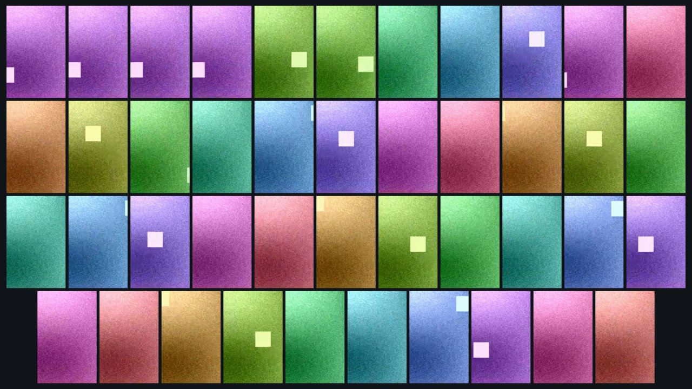

### Capturas

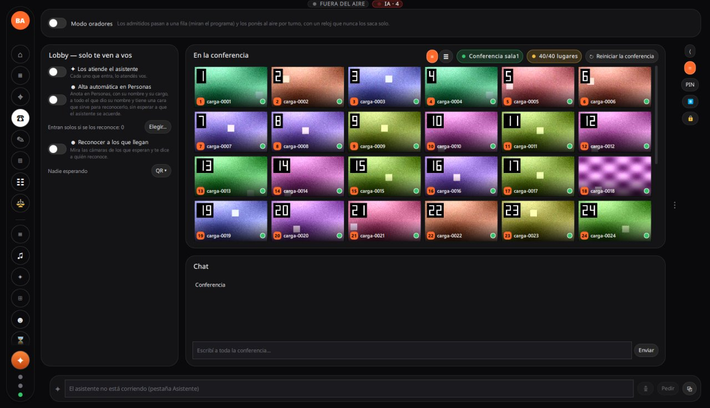

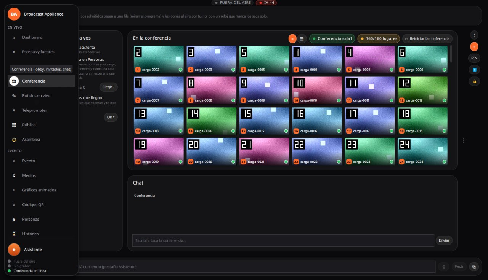

Con la entrada escalonada a 2/s, a los 10 s: 5 en la conferencia y en el lobby «0 esperando · 21
entrando», cada uno con su «entrando…»:

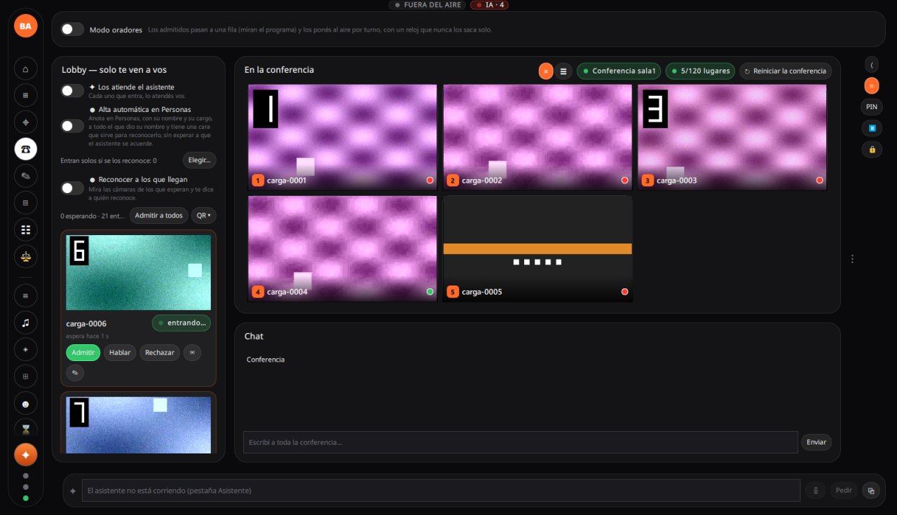

### Otras cosas vistas

- A mitad de la entrada de 120 la app pasó sola de la página Conferencia (donde la había puesto la
  medición) al Dashboard.
- ba-app no vuelve a su memoria del arranque: 1,9 GB privados al empezar y 5,7 GB con la sala vacía
  después de la escalera, con ~290-340 hilos (al arrancar, ~200 con cupo 40).
- Herramientas: `medir-sala.py` ahora guarda `capas.redYTrabajo` y `capas.playout` en cada muestra;
  `analizar.py` avisa cuando el `llvm-symbolizer` por Docker falla (con colima apagado daba las pilas
  de ba-app sin nombres y sin aviso). El `make dist-win-docker` dio bajo Wine, además de los de
  siempre, `test_vigia_traba` (resumirPila), `test_tiempo_real`, `test_plano_control` (rc=133) y
  `test_sse_epoch` (rc=133); no se corrieron en la PC.

## Después del rewrite de hilos (2026-11-02 noche, paquete 3824d1f5)

El paquete de `3824d1f5` (igual a master salvo un merge): el gateway con F1-F5 de
[PLAN-GATEWAY-FRAGMENTOS](../planes/PLAN-GATEWAY-FRAGMENTOS.md) (TURN y red en el mismo hilo,
capas R/T/D, colas compartidas de libwebrtc, decodificar con D3D11 en la placa, afinidad), como
mucho 4 en alta en la grilla y tope de 512 invitados. Arrancado con `--test --gw-arg=--turn-prueba`
(TURN sin pinggy), evento «prueba linea L0», hinchada `--modo grabado --hablan 1 --decodificar
todo` desde la Mac, `--remoto-cada 5` (muestreo liviano), 45-50 s de régimen; cada corrida, 2 min
como mucho. Crudas en `~/Proyectos/mediciones-carga/2026-11-02-nw/` (fuera del repo).

### 10 y 40: antes y después

| | ba-app | gateway CPU | gateway hilos | gateway cambios/s | motor de video de la placa |
|---|---|---|---|---|---|
| 10 directo, tarde (MFT) | 172 % | 405 % | 353 | 18,0k | — |
| 10 directo, D3D11 (antes de las colas) | — | 117 % | — | — | — |
| **10 directo, ahora** | **87 %** | **82 %** | **147** | **11,4k** | 31 % |
| 40 directo, tarde | 112 % | 220 % | 647 | 45,3k | 4-7 % |
| **40 directo, ahora** | **109 %** | **138 %** | **204** | **29,2k** | 46 % |
| 40 TURN mezcla 10 %, tarde | 111 % | 231 % | 647 | 46,7k | — |
| **40 TURN mezcla 10 %, ahora** | **120 %** | **162 %** | **205** | **28,1k** | 47 % |

- Grilla con 40: mosaico 30 cps sin perdidos, las 39-40 miniaturas en baja a 15,0 cps y 2-3 en
  alta a 29,5-30. Con 10: 4 en alta a 29 cps y 6 en baja a 15. Edad del audio 14,7-14,8 ms
  (antes 12,7-13,2), sin demoras propias; faltantes del retorno 0 en régimen.
- Lo que recibe el invitado: 28,8-29,4 cps de retorno, 0 congelamientos, 0 % de pérdida, RTT
  5-6 ms, 720p los 40. Salida de la PC 70 Mbps con 40.
- **Quién hace los cambios de contexto ahora** (40): `ba-rtc-work-#` ×3 13,3-13,6k/s,
  `(sin nombre)` ×149 5,2-5,7k (antes ×322, 9,9k), `ba-colas-rtc/#` 2,4-2,6k, `ba-colas-dec/#`
  ×6 2,4-2,8k, `ba-rtc-net-#` ×2 1,1-1,4k. `AudioEncoder`, `EncoderQueue`, `DecodingQueue` e
  `IncomingVideoStream` ya no existen como hilos. CPU: `ba-rtc-net` 38-54 %, `ba-rtc-work`
  20-26 %, `ba-colas-dec` 19-23 %, `webrtc-playout` 13 %, `grillas` 9 %. El TURN ya no tiene hilo:
  `turn.desde_webrtc` 11k pases/s y 11 % de un núcleo.
- **`uso.codecsVideo.entrega.celdas_placa` = 0**: las celdas de la grilla se achican todas por
  CPU (`celdas_cpu`), aunque `h264.achica_en_placa` diga sí; `enteros_placa` = todos. La
  decodificación sí es de la placa (53-54 decodificadores D3D11, motor de video al 46 %). La
  frontera #8 (`video.decodificado`) sigue en 2,9 ms por cuadro (tiempo de pared, con esperas).
- La interfaz: 10-11 demoras de 50-80 ms por corrida, ninguna de más de 1 s. El aviso de
  binding loop de `SalaParticipantes.qml:99` (`GrillaAdaptable`, `disp`) sale 2 veces por corrida
  (cuando entra y cuando se va la gente) y no se nota en la pantalla.

### Hasta que se rompe (TURN mezcla 10 %)

Con afinidad y prioridades de fábrica hasta 120 (60-120); después, por decisión del usuario,
`gateway.afinidad`, `procesador.mediosJuntos` y `procesador.prioridad` apagados y los procesos
en clase Normal («sin afinidad»: 80, 100, 120). Ojo: la tarea programada que arranca la app en
la sesión del usuario la lanzaba en **BelowNormal** (el launcher y el gateway heredaban eso;
ba-app subía sola a AboveNormal); las «sin afinidad» se lanzaron con `start /NORMAL`.

| Invitados | entran | ba-app | gateway | grilla en la app (baja p50 / p5, mosaico) | audio | `webrtc-playout` por pase | interfaz: trabas > 2 s (máx.) | «llega tarde» | invitado | Mac generadora |
|---|---|---|---|---|---|---|---|---|---|---|
| 40 | 40 | 120 % | 162 % | 15,0 / 15,0, 30 | 14,7 ms | 1,4 ms | 0 | 0 | 0 congel., 720p | 29 % |
| 60 | 60 | 176 % | 229 % | 15,1 / 15,0, 30 | 12,5 ms | 2,1 ms | 1 (3,4 s) | 0 | 0 congel., 720p | 38 % |
| 80 | 80 | 235 % | 317 % | 15,0 / 15,0, 30 | 11,4 ms | 3,1 ms | 3 (**8,0 s**, al irse) | 120 (al entrar) | 6 congel., 720p | 52 % |
| 80 sin afinidad | 80 | 190 % | 313 % | 15,0 / 15,0, 30 | 11,6 ms | 2,7 ms | 3 (**6,3 s**, al irse) | 212 (al entrar y 30 s después) | 0 congel., 720p | 56 % |
| 100 sin afinidad | 100 | 289 % | 421 % | 15,0 / 14,9, 30 | 11,9 ms | 4,1 ms | 6 (**14,0 s** al entrar, 13,8 s al irse) | 42 (al entrar) | 219 congel., 91 de 100 bajados a 360p/180p | 75-95 % |
| 120 | 120 | 328 % | 490 % | 11,7 / 10,3, 30 (2 perdidos) | — | 7,1 ms | 8 (**25,9 s**) | 801, cada ~30 s | 4453 congel., 1,8 % pérdida | 80-92 % |
| 120 sin afinidad | 120 | 323 % | 540 % | 15,0 / 7,0, 29 (7 perdidos) | — | **9,0 ms** | 6 (**24,9 s**) | 645 | 896 congel., 2 % pérdida, 109 de 120 bajados | 80-91 % |

(Memoria de la PC sin problema en ninguna: 16-20 GB disponibles, 20-29 GB comprometidos de 38;
la máquina entera a 25-45 %. Con 120 la edad del audio da números negativos: los relojes de las
dos máquinas se desfasaron; no se usa.)

**Qué se rompe primero: la interfaz de ba-app.** Ya con 80 se traba 6-8 s seguidos cuando se va
la gente de golpe (y 2,6-3,2 s cuando entra); con 100, 14 s al entrar y al irse, aunque en régimen
la grilla, el audio y el retorno siguen bien. Lo que corre la interfaz en esas trabas es casi
siempre `ba::app::ConferenceClient, evento 43` (los avisos de la conferencia encolados de a
cientos) y, con 120, también `ba::app::VentanillaMotor, evento 43`. Pilas: `Logs/dumps/A-20261102-22*-traba-*.dmp`
en la PC (quedan para `tools/caidas/analizar.py --pc`).

**Lo segundo, con 120: el hilo `webrtc-playout` del gateway llega al núcleo entero.** Saca el
audio de todos cada 10 ms (frontera #10) y crece más que lineal: 1,4 ms por pase con 40, 2,1
con 60, 2,7-3,1 con 80, 4,1 con 100 y **7,1-9,0 ms de 10 con 120** (ETW: 100 % de un núcleo).
Con eso aparecen las ráfagas de «mezcla programa/retornos: lo de Invitado N (audio) llega
tarde (16 bloques); no entra» cada ~30 s, la grilla baja (celdas a 7-12 cps, cuadros del
mosaico perdidos) y los retornos de los invitados se degradan. Entran los 120 igual.

**El techo útil en esta PC es ~80 invitados** (con la interfaz trabándose al entrar/irse de
golpe); 100 aguanta en régimen pero con trabas de 14 s; 120 no. La Mac que genera la carga
llega al 75-95 % desde 100: los congelamientos y la bajada de resolución del lado del invitado
con 100-120 son en parte de la Mac (hinchada decodificando 100-120 retornos), pero las trabas, el
audio tarde y la grilla son de la PC. No se subió de 120.

**Afinidad sí o no** (cada caso, una corrida): con 80, sin afinidad baja ba-app de 235 a 190 % y
saca los 6 congelamientos; con 120 no cambia nada de fondo (trabas de 25 s y playout saturado en
las dos). Dónde corre: con afinidad, con 120, el CCD del gateway (lógicos 12-23) a 65-74 % y el
otro (2-11) a 2-23 %; sin afinidad Windows llena el CCD0 (0-11 a 43-75 %) y deja el CCD1 a 17-42 %.
Los «dos núcleos a full» del Administrador de tareas son `webrtc-playout` y `control`/`interfaz`
de ba-app rotando en los lógicos 0-5, más las interrupciones de la placa de red en el 1 (DPC 7-11 %,
ISR 3-5 %).

**Hilos por núcleo con 120 sin afinidad (ETW 20 s, limpio)**: `ba-gateway/webrtc-playout` 100 %,
`ba-rtc-net-#` 183 % (repartido), `ba-rtc-work-#` 93 %, `ba-app/control` 80 %, `ba-colas-dec/#`
63 %, `ba-app/interfaz` 63 %, gateway sin nombre 54 %, `anillos-video` 32 %, `anillos-audio` 28 %.
En una corrida anterior el **SearchIndexer** de Windows se llevaba ~1,3 núcleos (4-9 % en casi
todos): se marcaron como «no indexar» los ~500 mil archivos de `C:\ba-pruebas` y en la siguiente ya
no apareció.

### Capturas

La Sala nueva («En la conferencia») con 40 y con 120 (118/120 lugares, la grilla se desplaza; una
celda todavía sin video):

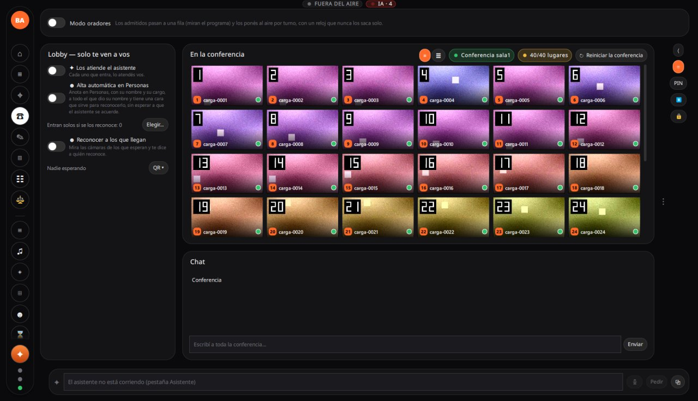

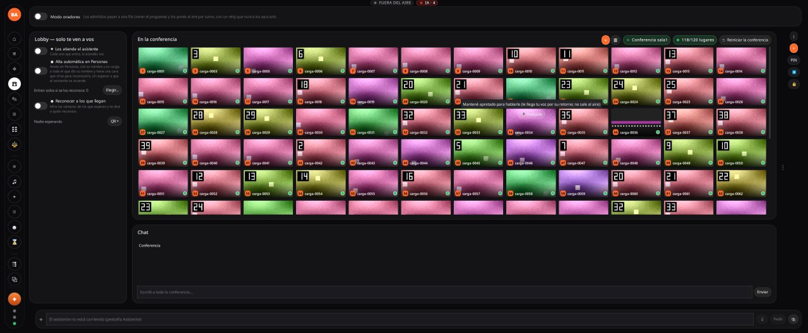

### Problemas vistos

- `medir-sala.py` a veces da «estable a los 0,06 s» (o negativo) y arranca el régimen durante la
  entrada (con `--remoto-cada 5`): los faltantes del retorno de la entrada (691 con 40) caen en
  el régimen. Herramienta de medición, no producto.
- `app_bucle_ui` del resumen arrastra el peor bucle de la corrida anterior (25,2 s en todas las de
  después de 120): mirar las trabas en `registro.txt`.
- Un bucle de espera con «ninja» o «clang» en la línea de comandos hace que el chequeo de
  «máquina quieta» de medir-sala diga «hay compilaciones».

## Campaña de la tarde (master b792325d)

Sala «prueba linea L0», grilla de personas al aire (`alta_hasta` 10), hinchada `--modo grabado
--hablan 1 --decodificar todo` (H.264 42e01f por omisión), medición de 60 s de régimen (las de
pinggy, 45 s). CPU en **% de un núcleo** (100 % = un hilo entero); «máquina» en % de los 24
hilos. Los cambios de contexto son la suma de los hilos de cada proceso (`NtQuerySystemInformation`).

### Por camino de entrada (A)

| Camino · invitados | ba-app CPU | gateway CPU | gateway hilos | gateway cambios/s | grilla (mosaico / celda) | edad del audio | el invitado recibe | salida / entrada de la PC | máquina |
|---|---|---|---|---|---|---|---|---|---|
| directo · 10 | 172 % | **405 %** | 353 | 18,0k | 30 / 27,0 cps | 13,2 ms | 30,0 cps, RTT 4,6 ms | 17,9 / 15,8 Mbps | 38 % |
| directo · 20 | 96 % | 128 % | 447 | 24,3k | 30 / 15,0 | 12,6 ms | 30,0 cps | 35,6 / 7,2 | 20 % |
| directo · 30 | 115 % | 179 % | 551 | 35,5k | 30 / 15,0 | 13,9 ms | 30,0 cps | 53,0 / 9,8 | 24 % |
| directo · 40 | 112 % | 220 % | 647 | 45,3k | 30 / 15,0 | 12,7 ms | 30,0 cps, RTT 6,0 ms | 70,1 / 11,8 | 23 % |
| TURN UDP · 10 | 104 % | 307 % | 354 | 18,5k | 30 / 27,9 | 12,4 ms | 29,9 cps | 18,0 / 15,3 | 24 % |
| TURN UDP · 20 | 96 % | 133 % | 448 | 25,9k | 30 / 15,0 | 12,2 ms | 30,0 cps | 35,9 / 6,2 | 16 % |
| TURN UDP · 30 | 96 % | 184 % | 549 | 35,9k | 30 / 15,0 | 13,5 ms | 30,0 cps | 53,4 / 8,8 | 18 % |
| TURN UDP · 40 | 129 % | 235 % | 647 | 46,6k | 30 / 15,0 | 13,4 ms | 29,9 cps, RTT 5,4 ms | 70,7 / 11,2 | 23 % |
| TURN TCP · 10 | 144 % | 379 % | 353 | 18,2k | 30 / 29,5 | 13,4 ms | 29,9 cps | 19,0 / 15,5 | 30 % |
| TURN TCP · 20 | 93 % | 141 % | 450 | 25,5k | 30 / 15,0 | 12,3 ms | 30,0 cps | 37,2 / 8,4 | 16 % |
| TURN TCP · 30 | 102 % | 180 % | 549 | 36,5k | 30 / 15,0 | 14,6 ms | 30,0 cps | 55,7 / 11,6 | 19 % |
| TURN TCP · 40 | 126 % | 242 % | 642 | 46,6k | 30 / 15,0 | 14,2 ms | 30,0 cps, RTT 6,2 ms | 73,9 / 14,7 | 23 % |
| TURN mezcla 10 % TCP · 10 | 144 % | 342 % | 363 | 18,5k | 30 / 29,2 | 14,0 ms | 30,0 cps | 18,2 / 14,9 | 27 % |
| TURN mezcla · 20 | 93 % | 130 % | 450 | 25,7k | 30 / 15,0 | 12,5 ms | 30,0 cps | 35,9 / 6,3 | 15 % |
| TURN mezcla · 30 | 107 % | 187 % | 547 | 36,4k | 30 / 15,0 | 12,8 ms | 30,0 cps | 53,5 / 9,1 | 19 % |
| TURN mezcla · 40 | 111 % | 231 % | 647 | 46,7k | 30 / 15,0 | 13,2 ms | 30,0 cps, RTT 5,8 ms | 71,0 / 11,4 | 22 % |

- **El TURN cuesta poco**: con 40, el gateway pasa de 220 % (directo) a 231-242 % (+5-10 %);
  el hilo `turn` gasta 24 % (UDP) a 29 % (TCP) de un núcleo. Los cambios de contexto suben 3 %.
- Sin pérdidas, sin congelamientos y la grilla clavada a 30 cps en todos los caminos hasta 40.
- **HD al dar la palabra** (`--palabra 5`, lo mide el gateway): p50 45-180 ms, p95 230-390 ms
  en todos los caminos; ninguna pasó de 0,8 s.
- **Demora de punta a punta** del audio (subida + estudio + retorno): 210-310 ms, pero el tramo
  del retorno compara el reloj de la PC con el de la Mac (desfasados 90-240 ms y Windows
  corrigiéndose en el medio de la serie): mirar solo la tendencia. Con los relojes de la misma
  máquina (la Mac) la misma cuenta da ~80 ms.
- **10 invitados sigue siendo el caso caro**: los diez en 720p30 y el gateway a 3-4 núcleos.
  Con la placa decodificando, **más caro que con VP8 por software** (ver B).

### Códec (B)

| | ba-app | gateway | gateway hilos | cambios/s | celda en alta | nota |
|---|---|---|---|---|---|---|
| H.264 por la placa · 10 | 172 % | 405 % | 353 | 18,0k | 27,0 cps | decodificado → BGRA 3,5 ms por cuadro (#8) |
| VP8 por software · 10 | 102 % | 305 % | 253 | 17,2k | 28,4 cps | 2,1 ms por cuadro; 21 congelamientos |
| H.264 por software (placa apagada) · 10 | 55 % | 83 % | **634** | 17,5k | **0 cps** | **no llega ningún cuadro** |
| H.264 por la placa · 40 | 112 % | 220 % | 647 | 45,3k | 15,0 cps | |
| VP8 · 40 | 107 % | 203 % | 509 | 33,8k | 15,0 cps | 25 % menos cambios de contexto |
| H.264 por software · 40 | 124 % | 187 % | **1457** | 42,4k | **0 cps** | idem |

- Decodificar en la placa **no ahorra CPU en el gateway** con esta implementación: con 10 en
  720p gasta un núcleo más que VP8 por software. Lo caro no es decodificar sino lo de alrededor:
  `(sin nombre)` (hilos de Media Foundation/D3D11, 261 con 10) 170 %, `IncomingVideoStream`
  107 %, `DecodingQueue` 48 %, y la frontera #8 (cuadro decodificado → BGRA + grilla + ba-app)
  tarda 3,5 ms por cuadro contra 2,1 ms con VP8: bajar el NV12 de la placa, pasarlo a I420 y
  después a BGRA.
- `--codec vp8` de hinchada no da VP8 puro: 9 de 40 (5 de 10) siguen subiendo H.264
  («H264 42e01f pm1 + VP8» en sus estadísticas).

### Ráfaga, grabar y transmitir, resistencia, 60 y 80 (C-F)

| | ba-app | gateway | gateway hilos | resultado |
|---|---|---|---|---|
| C · 40 en ráfaga, directo | 120 % | 221 % | 647 | **40/40** con medios en 2,0 s; primer cuadro del retorno 0,98 s |
| C · 40 en ráfaga, TURN mezcla | 108 % | 208 % | 603 | **solo 22/40** conectan; el resto queda «conectando» |
| C · 40 en ráfaga, TURN UDP | 125 % | 204 % | 602 | **solo 21/40** |
| D · 40 grabando y transmitiendo (SRT local) | 120 % | 239 % | 647 | igual que sin grabar (+8 % app); «Video Codec» de la placa 13 % |
| E · 40 durante 17 min (TURN mezcla) | 107 % | 242 % | 660 | estable: hilos planos desde el minuto 4, memoria del gateway 1,6→2,2→1,7 GB, audio 11 ms, 0 faltantes |
| F · 60 (TURN mezcla) | 192 % | 396 % | 842 | 60/60, grilla 30 cps, 106 Mbps de salida, máquina 32 % |
| F · 80 (TURN mezcla) | 200 % | 411 % | 964 | **entran 68**: el cupo tiene tope 64 (+4 de reserva, `kMaxInvitados`) |

(E se pidió de 30 min y se cortó a los 17 por pedido del usuario; F-60/80 con
`turn.maxAsignaciones` 96 y `direct.rtcMax` 40199, vueltos después a 64 y 40099.)

### Pinggy (el camino de producción, por internet)

La .177 no tiene cuenta de pinggy: se usó **pinggy gratis** (dirección al azar, se corta a los
60 min). El medio sale de la Mac a internet, entra a pinggy y vuelve a la casa: la conexión de
la casa lleva todo dos veces. 45 s de régimen cada una.

| Pinggy · invitados | el invitado recibe | pérdida | RTT | congelamientos | retorno (resolución) | salida de la PC | punta a punta (audio) |
|---|---|---|---|---|---|---|---|
| UDP · 2 | 29,4 cps | 0,04 % | 147 ms | 0 | 360p/180p | 1,0 Mbps | 172 ms |
| UDP · 5 | 28,6 cps | 0,32 % | 174 ms | 18 | 720p×3, 360p, 180p | 6,5 Mbps | 339 ms |
| UDP · 10 | 28,1 cps | 0,37 % | 187 ms | 21 | 180p×10 | 5,2 Mbps | 388 ms |
| UDP · 20 | 23,3 cps | 0,26 % | 236 ms | 18 | 180p×18 | 7,2 Mbps | 886 ms |
| TCP · 2 (otra sesión de pinggy) | 29,8 cps | 0 | 525 ms | 3 | | 2,0 Mbps | 677 ms |
| TCP · 5 | 27,9 cps | 0 | 561 ms | 8 | | 5,9 Mbps | 726 ms |
| TCP · 10 | 16,5 cps | 0 | 1060 ms | 10 | 180p×10 | 3,6 Mbps | 2,25 s |
| TCP · 20 | 27,3 cps | 0 | 244 ms | 4 | 180p×20 | 7,7 Mbps | 641 ms |
| TCP · 30 | 20,2 cps (entran 28) | 0 | 361 ms | 1 | 180p×28 | 8,1 Mbps | 821 ms |
| mezcla 10 % TCP · 10 | 28,0 cps | 0,12 % | 241 ms | 11 | 720p/360p/180p | 5,8 Mbps | 460 ms |
| mezcla · 20 | 28,2 cps | 0,15 % | 206 ms | 11 | 180p×20 | 8,4 Mbps | 423 ms |

- **Techo de pinggy gratis: ~7-8 Mbps** en cada sentido, por UDP o por TCP. Con 5 invitados
  todavía anda; desde 10 el control de congestión del gateway baja el retorno de todos a
  320×180 (~200-350 kbps cada uno) y la grilla recibe a 14-23 cps. Con 40 no se probó: harían
  falta ~70 Mbps.
- **No es la casa**: hay 42,8 Mbps de subida. Tampoco es hinchada (`--decodificar todo`
  decodifica todo lo que recibe) ni la medición (la placa de red de la PC dice lo mismo). Es el
  túnel: el RTT depende del servidor que toca en cada conexión (525-1060 ms en una sesión,
  150-240 ms en otra), y por TCP la cola del túnel sube el RTT a ~1 s (TCP·10).
- Para un evento real con más de ~5 invitados de afuera, pinggy gratis no alcanza: cuenta paga
  (medir), WireGuard o un servidor propio.

### Núcleos: «casi todo el trabajo en dos núcleos» (G)

ETW de 20 s con 40 invitados (`--etw 20`), directo y por TURN mezcla, con el muestreo cada 5 s:

| Núcleo lógico | Ocupado (directo / mezcla) | DPC | ISR | MHz | Hilos que más usan ese núcleo (directo) |
|---|---|---|---|---|---|
| 0 | 33 / 34 % | 0,8 % | 0,5 % | 4596 | muestreo (powershell) 7,6 %, ba-gateway/ba-rtc-net 4,6 % |
| 1 | 48 / 44 % | **5,2 %** | **2,4 %** | 4595 | powershell 13,6 %, ba-rtc-net 6,5 %, ba-rtc-work 3,4 %, grillas 2,1 % |
| 2 | 31 / 31 % | 0 | 0 | 4528 | ba-rtc-net 9,2 % |
| 3 | 26 / 26 % | 0 | 0 | 4544 | ba-rtc-work 3,6 %, webrtc-playout 1,9 % |
| 4 | 40 / 33 % | 0 | 0 | 4574 | powershell 9,7 %, ba-rtc-work 5,6 % |
| 5 | 35 / 44 % | 0 | 0 | 4591 | powershell 11 % |
| 6-11 | 14-25 % | 0 | 0 | 4380-4490 | ba-rtc-net, ba-rtc-work, webrtc-playout, grillas (1-4 % cada uno) |
| 12-13 | 11-12 % | 0 | 0 | 4325-4341 | svchost, WmiPrvSE (<1,5 %) |
| 14 | 19 / 14 % | 0 | 0 | 4365 | ba-app/interfaz 9,2 % |
| 15-19 | 7-17 % | 0 | 0 | 4250-4350 | ba-app: anillos-video, motor-entradas, anillos-audio |
| 20 | 23 / 22 % | 0 | 0 | 4449 | **ba-app/control 15,3 %** |
| 21-23 | 6-14 % | 0 | 0 | 4240-4350 | ba-app y ba-rtc-net |

- **Con la app y la carga de la prueba no hay dos núcleos saturados**: el más ocupado llega a
  48 %. El gateway reparte sus hilos por los núcleos 0-11 (el primer CCD) y ba-app los suyos
  por los 14-23 (el segundo, su afinidad de `Prioridad`). Ningún hilo pasa de medio núcleo:
  `ba-rtc-net` 50 %, `(sin nombre)` 49 % (suma de ~320 hilos), `IncomingVideoStream` 32 %
  (suma de 80), `ba-rtc-work` 27 %, `turn` 25 %, `ba-app/control` 20 %.
- **Las dos que sí se vieron saturadas eran de la medición**: con el muestreo viejo
  (`muestrear-win.ps1` por WMI cada 1 s) los núcleos lógicos **12 y 13** (los dos hilos de UN
  núcleo físico) estaban al **88-90 %**, todo en `WmiPrvSE` (~1,1 núcleos): la consulta de
  procesos e hilos por WMI con 300-650 hilos en el gateway. Es lo que muestra el Administrador
  de tareas como «dos núcleos casi llenos». Arreglado en `tools/carga/muestrear-win.ps1`
  (hilos con `NtQuerySystemInformation`, procesos con `Get-Process`): ahora 12-13 quedan al
  10-12 %.
- **La placa de red** (Intel I225-V, sin RSS: no aparece en `Get-NetAdapterRss`) manda todas sus
  interrupciones a los núcleos **0 y 1** (vectores 113/114/146/163, ~110 mil por 20 s). El
  núcleo 1 carga 5 % de DPC y 2,4 % de ISR con 70 Mbps: se nota pero no satura.
- La frecuencia se queda en 4,2-4,6 GHz en todos los núcleos (más alta en el primer CCD, donde
  trabaja el gateway): no hay estrangulamiento térmico.
- El muestreo de la prueba todavía cuesta: el PowerShell de `muestrear-win.ps1` y `etw-win.ps1`
  usa ~30 % de un núcleo, repartido entre 0, 1, 4 y 5.

## Medición de la mañana (master 87f4d0d8, VP8 por software, solo directo)

Sala de prueba «prueba linea L0» (la misma de las mediciones de la Mac): grilla de personas al
aire con `alta_hasta` 10 (hasta 10 personas, todas en alta 720p30; con más, miniaturas en baja
360p15 salvo el orador), hinchada `--modo grabado --hablan 1`, 60 s de régimen y 20 s de
cuadros por celda. CPU en **% de un núcleo** (como `ps`: 100 % = un hilo entero); la máquina
entera en % de sus 24 hilos.

| Invitados | 10 | 20 | 30 | 40 |
|---|---|---|---|---|
| Todos con video / estable (s) | 2 / 8 | 3 / 25 | 4 / 13 | 5 / 21 |
| ba-app CPU p50 (p95) | 99 % (110) | 69 % (74) | 91 % (97) | 107 % (116) |
| ba-app hilos (máx) | 213 | 246 | 274 | 285 |
| ba-app memoria: working set / privada máx | 1,7 / 1,8 GB | 1,8 / 2,0 GB | 1,8 / 2,4 GB | 1,7 / 2,8 GB |
| ba-gateway CPU p50 (p95) | **320 % (363)** | 115 % (127) | 161 % (176) | 201 % (226) |
| ba-gateway hilos (máx) | 126 | 206 | 285 | 366 |
| ba-gateway memoria (working set) | 0,8 GB | 1,2 GB | 1,4 GB | 1,9 GB |
| Cambios de contexto/s: app / gateway | 5,7k / 11,6k | 5,6k / 17,6k | 5,8k / 25,6k | 5,9k / 32,9k |
| Máquina entera (24 hilos), CPU p50 | 31 % | 17 % | 23 % | 19 % |
| GPU (motor 3D de ba-*) / memoria dedicada | 8 % / 0,4 GB | 8 % / 0,5 GB | 8 % / 0,5 GB | 8 % / 0,5 GB |
| Grilla en el programa: mosaico | 30,0 cps | 30,0 cps | 30,0 cps | 30,0 cps |
| — celdas en baja (p50) | — | 15,0 cps | 15,0 cps | 15,0 cps |
| — celdas en alta (p50 / p5) | 29,9 / 29,8 | 30,0 / 30,0 | 30,0 / 30,0 | 30,0 / 29,9 |
| — cuadros perdidos | 0 | 0 | 0 | 0 |
| Edad del audio de los invitados en la mezcla (p50) | 11,6 ms | 11,9 ms | 14,4 ms | 14,5 ms |
| Faltantes del retorno de audio (máx en 10 s) | 0 | 0 | 0 | 0 |
| Red de la PC: sale / entra (Mbps) | 17,6 / 16,6 | 35,6 / 6,2 | 51,4 / 8,6 | 69,6 / 10,7 |
| Conectar: offer→medios p95 / desde el lanzamiento p95 | 20 ms / 1,2 s | 45 ms / 2,1 s | 23 ms / 3,1 s | 26 ms / 4,0 s |

Cómo leerla:

- **10 invitados es el caso caro para el gateway**: los diez van en alta (720p30), y el gateway
  decodifica diez 720p por software para la grilla (3,2 núcleos). Con 11 o más pasan a baja
  (360p15) y el gateway baja a ~1,2 núcleos con 20 y sube ~0,4 núcleos cada 10 invitados.
- La salida crece ~1,7 Mbps por invitado (el retorno 640×360 de cada uno); la entrada, ~0,2 Mbps
  por invitado en baja más ~1,5 Mbps por cada uno en alta.
- ba-app crece poco con la gente (~3 hilos por invitado); el gateway, ~8 hilos por invitado
  (en la Mac, ~1,3).
- La grilla queda **clavada a 30 cps** en el mosaico y en cada capa, sin perdidos, de 10 a 40.

### Prueba de sala desde la app (generador externo)

Con la **Prueba de sala** de la página Conferencia (`prueba_sala_arrancar` con generador
externo y hinchada en la Mac usando la credencial de prueba), 40 de 40 con video, 0 fallidos y
0 cortes; video al entrar p50 545 ms (p95 2,8 s); **HD al dar la palabra p50 102 ms (p95 284)**;
subida pico 9,6 Mbps, bajada pico 67,5 Mbps; memoria disponible mínima 21,4 GB.

## Límites y recomendaciones

- **Hasta 60 invitados medidos con margen** (campaña de la tarde): con 60 por TURN, gateway
  ~4 núcleos, ba-app ~2, la máquina entera al 32 % y la grilla a 30 cps sin pérdidas. **El cupo
  no deja pasar de 64** (`kMaxInvitados`, más 4 de reserva: con 80 pedidos entraron 68). Ojo
  con la memoria privada de ba-app: 3,5 GB con 40, 6,2 GB con 60, 6,9 GB con 68.
- **Por TURN casi como directo** (+5-10 % de gateway con 40). **Por pinggy gratis, unos 5
  invitados** (techo de ~7-8 Mbps del túnel; ver «Pinggy»).
- **Entrar todos a la vez por el TURN falla** (C): en ráfaga solo conectan ~la mitad; entrando
  de a uno cada 100 ms entran todos. Directo, la ráfaga de 40 entra entera en 2 s.
- **La red manda antes que la CPU**: con 40, 70 Mbps de salida. Por cable a 1 Gbps sobra; por
  Wi-Fi o por un túnel/servidor propio, medir el enlace (tarjeta «Enlace») antes del evento.
- **Ojo con `alta_hasta`**: subirlo (más gente en 720p30) cuesta ~0,3-0,4 núcleos de gateway por
  invitado en alta en esta PC (con la placa decodificando, igual o más que por software).
- **Tope de 32 conexiones por dirección IP** (`room.maxConexionesPorIp`, de fábrica 32): con un
  solo generador en otra máquina, el 33º invitado se rechaza («esa IP ya tiene 32») y reintenta
  sin parar. Para medir más de 32 desde una máquina, subirlo en el evento de prueba (se usó 64).
  **En un evento real con muchos invitados detrás de la misma IP pública (NAT de un edificio, una
  red de celular), pasa lo mismo**: revisar ese ajuste.
- RAM a 2666: el kit es de 3600 y el XMP/DOCP está apagado en el BIOS; no limita estas pruebas,
  pero prenderlo es gratis para lo que corre en CPU (gateway).

## Comparación con la Mac

De la medición de la mañana (VP8 por software en la PC). La campaña de la Mac de la tarde quedó
pausada con solo directo 10-40 medido (`mediciones-carga/2026-11-02-campana/mac/`).

MacBook Pro M1 Pro (8 núcleos), 32 GB, macOS 26, misma sala y mismo hinchada, pero **la app y
hinchada en la misma Mac** (`mediciones-carga/2026-11-02-al-final`, la serie después de los arreglos de la grilla; los
números de la Mac incluyen la carga del generador en la máquina).

| Invitados | 10 | 20 | 30 | 40 |
|---|---|---|---|---|
| ba-app CPU p50 — PC / Mac | 99 / 53 % | 69 / 60 % | 91 / 73 % | 107 / 86 % |
| ba-gateway CPU p50 — PC / Mac | 320 / 93 % | 115 / 71 % | 161 / 88 % | 201 / 108 % |
| ba-app memoria — PC (working set) / Mac (RSS) | 1,7 / 3,3 GB | 1,8 / 3,5 GB | 1,8 / 3,8 GB | 1,7 / 4,1 GB |
| ba-gateway hilos — PC / Mac | 126 / 66 | 206 / 71 | 285 / 82 | 366 / 93 |
| Máquina entera p50 — PC (24 hilos, sin generador) / Mac (8 núcleos, con hinchada) | 31 / 40 % | 17 / 37 % | 23 / 43 % | 19 / 50 % |
| Celdas en alta p50 — PC / Mac | 29,9 / 28,4 cps | 30,0 / 29,8 | 30,0 / 28,9 | 30,0 / 30,1 |
| Audio, edad p50 — PC / Mac | 11,6 / 10,9 ms | 11,9 / 10,4 | 14,4 / 12,9 | 14,5 / 14,1 |
| Faltantes del retorno (máx 10 s) — PC / Mac | 0 / 0 | 0 / 10 | 0 / 8 | 0 / 25 |
| Salida de red (Mbps) — PC / Mac | 17,6 / 16,5 | 35,6 / 32,5 | 51,4 / 50,4 | 69,6 / 67,9 |

En resumen: la PC gasta más CPU por proceso (el gateway sin códecs por hardware, el motor
con más trabajo en CPU) pero tiene 3 veces más hilos de hardware y queda mucho más holgada
como máquina; usa la mitad de memoria; la grilla y el audio salen igual o mejor.

## Capturas

La Conferencia con 10 invitados (cada uno con su número y su video):

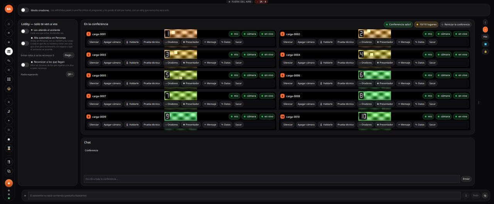

La grilla de personas al aire con 10 (todos en alta) y con 40 (miniaturas en baja, el orador
resaltado):

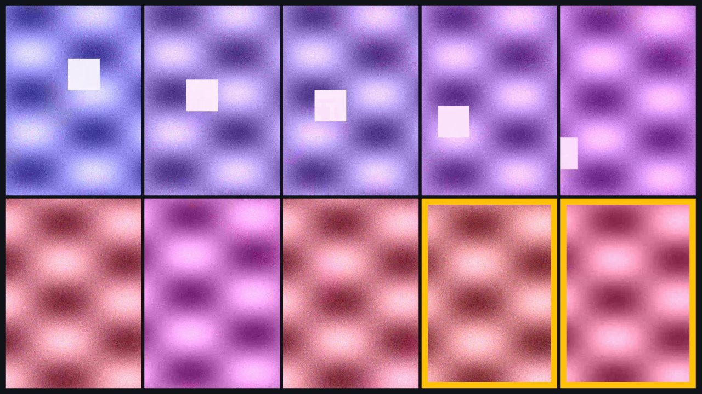

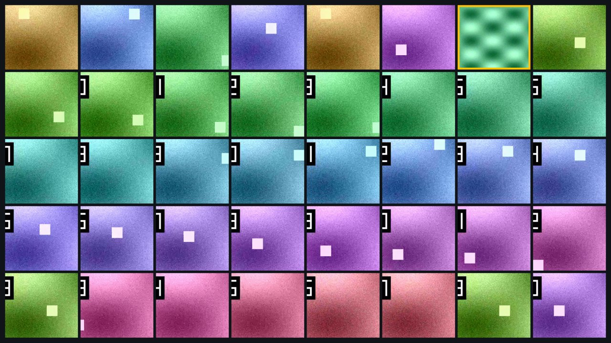

La Conferencia con 40 y la Prueba de sala corriendo (columna derecha), y el panel de cerca:

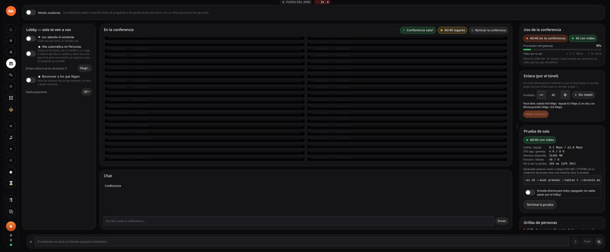

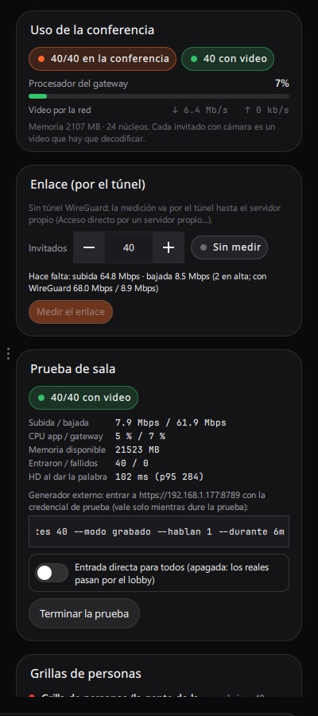

> **Defecto visto en la captura de 40**: la lista «En la conferencia» encoge las filas hasta
> dejarlas como rayas vacías en lugar de desplazarse (con 10 se ven bien). Anotado para
> arreglar; no afecta la medición. Captura de la campaña de la tarde (40 por TURN UDP), la
> ventana y la tarjeta sola:

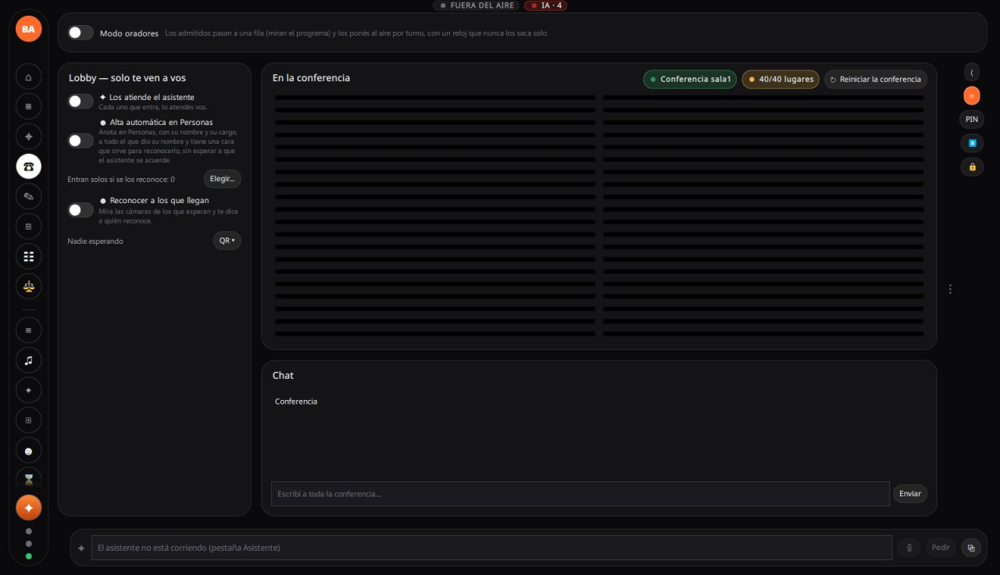

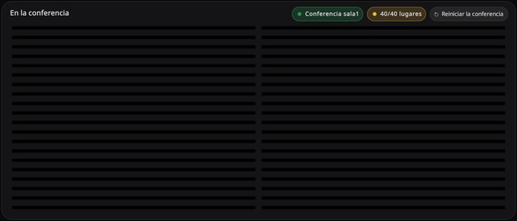

## Problemas encontrados en esta medición

Campaña de la tarde:

- **H.264 por software en Windows no entrega cuadros** (`gateway.decodificarConPlaca` apagado →
  «MediaFoundation (software)»): la grilla recibe 0 cps de todas las celdas (113 repetidos, 0
  nuevos) y el gateway crea hilos sin parar (634 con 10, 1457 con 40). Es la caída automática
  cuando la placa falla: hoy dejaría a todos sin video. Con la placa anda bien.
- **Ráfaga por TURN**: 40 a la vez por el TURN (UDP o mezcla) → 21-22 conectan, el resto queda
  en «conectando» (la oferta se acepta pero los medios nunca conectan). El TURN acumuló
  `rechazosPeer` 379 en la tarde. Directo no pasa.
- **El muestreo de la prueba ensuciaba la medición**: WMI por hilo tardaba 15-20 s por muestra
  (las primeras 7 mediciones se descartaron) y `WmiPrvSE` comía ~1,1 núcleos en los núcleos
  12-13. Arreglado (`muestrear-win.ps1`); ver «Núcleos».
- `room.maxConexionesPorIp` quedó en 48 tras una corrida (medir-sala no lo devolvió); se volvió a
  32 a mano.
- `ba-app/latencia-consulta` gasta 31 % de un núcleo con 40 (la consulta de `estudio_latencia`
  de la prueba, cada 5 s): revisar si es solo de la medición.
- El retorno a los invitados lo calcula hinchada contra el reloj de la Mac: los relojes difieren
  90-240 ms y `w32tm /resync` corrigió la PC en el medio de la serie (la «demora de punta a
  punta» saltó de ~300 a ~215 ms entre dos corridas iguales).

Medición de la mañana:

- Al cambiar de evento por MCP (`evento_cambiar`) justo después del primer arranque del paquete
  nuevo, el launcher dio a la app por **colgada** («dejó de latir») a los 10 s, sacó un volcado
  (`Logs/dumps/A-20261102-114932-colgado.dmp`) y la relanzó; el evento nuevo abrió bien. La
  pila: el hilo que cierra el motor queda esperando en `gst_element_set_state` →
  `gst_pad_stop_task` (el candado del flujo de un pad que tiene otro hilo), un abrazo mortal de
  GStreamer al bajar una cadena. El segundo cambio (de vuelta a «Principal») cerró limpio.
- Con el generador externo, la Prueba de sala muestra **«fallidos 40»** apenas arranca (antes de
  que entre nadie); se corrige solo cuando entran.
- Bajo Wine (el armado en Docker) fallaron 16 tests, casi todos rc 133/3 del entorno; además de
  los conocidos: test_cupos, test_gateway_http, test_mirada, test_sse_epoch y test_tiempo_real
  (sin revisar en la PC).

## Cómo repetir la medición

1. Paquete de Windows (`make dist-win-docker`) con hinchada de Windows en `extern/hinchada`
   (`make deps-hinchada`); desplegar en `C:\ba-pruebas\BroadcastAppliance` y arrancar en la
   sesión del usuario (`C:\ba-pruebas\app.ps1 -Que arrancar`).
2. Evento de prueba con el gateway en la LAN (`gateway.bind` 0.0.0.0) y, para más de 32 desde
   una sola máquina, `room.maxConexionesPorIp` 64. Comprobar con `evento_en_curso`.
3. Desde la Mac, con la app de la Mac **cerrada**, colima apagada y sin compilaciones:

   ```sh
   ssh -f -N -L 18790:127.0.0.1:8790 windows
   export BA_MCP_URL=http://127.0.0.1:18790/mcp
   export BA_MCP_TOKEN=$(ssh windows 'C:\ba-pruebas\BroadcastAppliance\bin\64bit\ba-mcp.exe --token' | tr -d '\r\n')
   for c in directo turn-udp turn-tcp turn-mezcla:10; do for n in 10 20 30 40; do
     tools/carga/medir-sala.py --ba-mcp dist/BroadcastAppliance.app/Contents/Resources/bin/64bit/ba-mcp \
       --hinchada extern/hinchada/macos-arm64/hinchada \
       --remoto windows --url http://192.168.1.177:8787 --participantes $n --cupo --cupo-final 2 \
       --camino $c --regimen 45 --medir-grilla-s 15 --etw 20 --palabra 5 \
       --salida ~/Proyectos/mediciones-carga/<fecha>-pc177/$c-$n \
       -- --modo grabado --hablan 1 --decodificar todo
   done; done
   ```

   Los caminos por TURN y `pinggy[:udp|tcp|mezcla:PCT]` necesitan pinggy prendido en el evento
   de prueba (`acceso_remoto_conectar`; el TURN solo arranca con pinggy) y, para UDP,
   `pinggy.turnUdp`. Apagarlo al terminar. `--etw` necesita la sesión ssh como administrador.
   Cada corrida, 2 minutos como mucho (pedido del usuario).

4. Al terminar: volver al evento que estaba abierto, `app_quit`, que no quede `ba-*.exe` ni
   tareas `\ba-*` (`schtasks /Query`), y cerrar el túnel.
