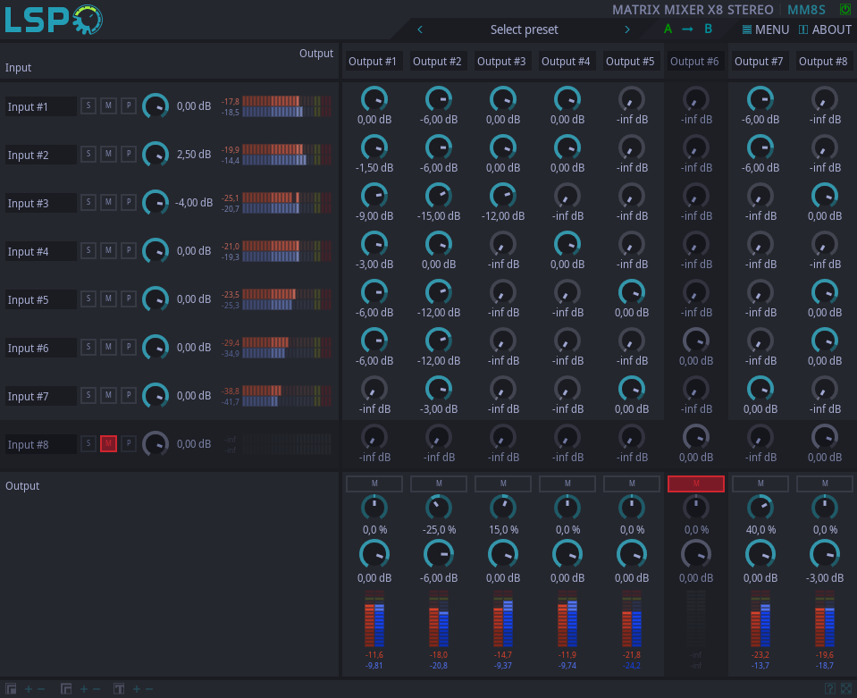

# Matrix Mixer para LSP: material para proponerlo

> **Nada de esto se envió.** Es el material listo por si se decide proponerle
> el módulo a Linux Studio Plugins. Lo de abajo de la línea va en inglés, tal
> cual se mandaría.
>
> Cómo está organizado LSP: cada plugin es un repo propio dentro de la
> organización `lsp-plugins` en GitHub (por ejemplo `lsp-plugins/lsp-plugins-mixer`),
> y el repo principal `lsp-plugins/lsp-plugins` los junta (`modules.mk`,
> `plugins.mk`). Un tercero no puede crear repos en esa organización, así que
> el camino es:
>
> 1. Publicar `third_party/lsp-plugins-matrix-mixer/` como repo propio
>    (por ejemplo `github.com/blairq/lsp-plugins-matrix-mixer`), con su historia
>    desde cero: el directorio ya es un repo de módulo completo.
> 2. Abrir un issue en `lsp-plugins/lsp-plugins` con el texto de abajo,
>    ofreciendo el módulo y los dos parches:
>    - `0001-lsp-plugins-add-matrix-mixer.patch` → `lsp-plugins/lsp-plugins`
>    - `0002-lsp-plugins-shared-add-matrix-mixer.patch` → `lsp-plugins/lsp-plugins-shared`
>
>    El mantenedor (Vladimir Sadovnikov, sadko4u) suele preferir que se lo
>    consulte antes con un issue: decide él los identificadores (base LADSPA,
>    IDs de VST) y si el repo pasa a la organización.
>
> Lo que falta probar antes de mandarlo: el build en Linux (LV2, LADSPA, VST2,
> VST3, JACK) y en Windows; acá se compiló y probó solo CLAP + interfaz en macOS
> arm64.
>
> Regenerar las capturas, los íconos y las configs:
> `.venv/bin/python tools/docs/lsp-matrix-mixer-doc.py` (Mac). Los parches salen de
> `tools/deps/lsp-modulo-propio.sh`, que hace lo mismo en el árbol de build.

---

## Proposal: Matrix Mixer plugin series

Hello! I'd like to offer a new plugin series for LSP: **Matrix Mixer x4/x8
Mono/Stereo**. It is written as a regular LSP module, following the
structure and conventions of `lsp-plugins-mixer`, which it is based on.

### What it does

Each input is routed to each output with an individual gain for every
crosspoint of the matrix, so any output can be its own mix of any inputs:
monitor mixes, mix-minus feeds, submixes and signal splits inside one plugin
instance. It came from a broadcast use case (a mix-minus for a remote guest,
a different monitor mix than the program, a clean recording of the
microphones), where a single matrix is much easier to manage than a chain of
mixers.

- **Inputs** (rows): editable label (KVT, like the Mixer), solo, mute, phase
  invert, gain and a level meter.
- **Crosspoints**: one gain knob each, from -inf to +12 dB. The default matrix
  is the identity one (input N goes to output N only), so a fresh instance
  passes the audio through unchanged.
- **Outputs** (columns): editable label, mute, gain, balance (stereo) and a
  level meter. Muting an input or an output dims its whole row or column,
  like soloing/muting does in the Mixer.
- **Stereo**: each crosspoint routes left to left and right to right.
- **Bypass**: the identity, with the usual bypass crossfade.

### Implementation notes

- All gains (inputs, crosspoints, outputs/balance) are ramped with
  `dsp::lramp*` to avoid zipper noise.
- Silent crosspoints (-inf on both the old and the new gain) are skipped, so
  unused crosspoints take no processing time.
- In-place processing is safe: every input is copied into its own gained
  buffer before any output is written.
- Port IDs follow the Mixer where they mean the same thing (`cs_N`, `cm_N`,
  `ci_N`, `cg_N`); new ones are `mx_I_O` (crosspoints), `om_N`, `ob_N`, `og_N`
  (output strip), `il_N`/`ol_N` (meters).
- UI: `res/main/ui/plugins/util/matrix_mixer/{mono,stereo}.xml`, built only
  from stock widgets and theme colors; checked in the four schemas (legacy,
  legacy-dark, modern, paper).
- Translations: default/us, plus de, es, fr, it, ru for the bundle and the
  default labels.
- Docs: `src/doc/manuals/plugins/matrix_mixer.php`, screenshots, example
  configs (`res/doc/configs`) and icons for the four schemas (`res/main/icons`).

### Integration

Two small patches, attached:

1. `lsp-plugins`: declares the module in `modules.mk` and adds it to
   `plugins.mk` (alphabetical order, after the Matcher).
2. `lsp-plugins-shared`: `LSP_LADSPA_MATRIX_MIXER_BASE (LSP_LADSPA_BASE + 300)`
   (the next free range after the Deesser) and the developer entry used by
   the plugin metadata. I'm happy to change the LADSPA base, the VST2 IDs
   (`mx4m`, `mx8m`, `mx4s`, `mx8s`), the VST3 UIDs and the developer entry
   to whatever fits the project.

Suggested CHANGELOG line: `* Implemented Matrix Mixer Plugin series.`

### Testing

- Built inside the 1.2.35 source tree (`make config FEATURES='clap ui'`) on
  macOS arm64 with clang, no warnings from the module.
- Automated test through a CLAP host: identity by default, crosspoint sum,
  input mute/solo/phase, output gain/mute, bypass and stereo balance (DC
  signals, values checked after the ramps settle).
- The UI was opened and captured in all four schemas for the 4 variants.
- Not yet tested: Linux (LV2/LADSPA/VST2/VST3/JACK) and Windows builds.

The module is available at: `<repository URL>`

Thank you for LSP!
