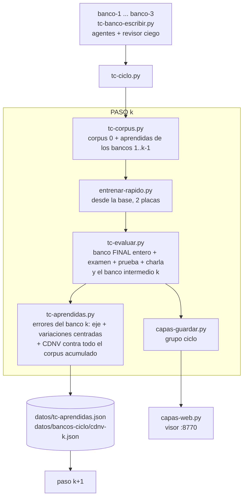

# El ciclo de bancos: aprender de los errores en frases de operador

Un sistema de entrenamiento en pasos: el modelo local se entrena, se mide con
pedidos de operador que nunca vio, y lo que erró se vuelve corpus para el modelo
siguiente. Este documento explica el porqué, las reglas, cada script, cómo se
corre y cómo se lee lo que sale. Va con
[bucle-tool-calling.md](bucle-tool-calling.md) (el bucle de siempre, el perfil, el
evaluador) y [bucle-corpus.md](bucle-corpus.md) (la geometría CDNV).

Estado al 18/10/2026: los scripts están escritos y los tres bancos intermedios
existen; **el ciclo todavía no se corrió** (ver «Estado actual»).

## Palabras que se usan

| palabra | qué es |
|---|---|
| **perfil** | el conjunto de herramientas que ve el modelo. Hoy `vivo6`: 108 herramientas más las dos pseudo-herramientas `derivar` y `falta_dato` (`datos/perfiles/vivo6.json`). Se elige con `BA_PERFIL=vivo6` |
| **corpus 0** | el corpus de siempre: lo arma `tc-corpus.py` rindiendo las plantillas de `datos/tc-anotaciones.json` con estados del aparato inventados. Está congelado: el ciclo no lo reescribe |
| **banco final** | `datos/orientacion.jsonl` (1.423 frases de operador) más el examen `datos/entrenamiento/examen.jsonl` (105 casos). Nunca se entrena con ellos: es la vara con que se miden todas las versiones |
| **banco intermedio** | `datos/bancos-ciclo/banco-N.jsonl` (N = 1, 2, 3): pedidos de operador escritos de cero para el ciclo. Se usan dos veces: primero miden a un modelo que no los vio, después lo que ese modelo erró entra al corpus. Por eso se consumen |
| **nube** | las frases de una herramienta, cada una como un vector: el estado oculto del modelo justo donde va a escribir el nombre de la herramienta (después de `<function=`). Una nube por herramienta (y una para `derivar`) |
| **CDNV** | «variación dentro de la nube sobre distancia entre nubes»: para dos herramientas, (varianza de una + varianza de la otra) dividido por 2 veces la distancia al cuadrado entre sus centros. Cuanto más chico, más separadas están. Acota el error de un clasificador al centro más cercano (error ≤ 4 · CDNV). Objetivo del repo: 0,028 (cota 11 %). Lo calcula `tc-geometria.py` |
| **radio de una nube** | la dispersión típica de sus frases alrededor del centro. «A 2,7 radios» es qué tan lejos queda una frase de su nube, en esas unidades |
| **eje** | la frase del operador que el modelo erró, **tal cual** (con los nombres propios reemplazados por huecos como `{audio}`). Es el centro alrededor del cual se arma lo aprendido |
| **variaciones** | el mismo pedido dicho de otras maneras, escritas por un agente; se eligen las que dejan al eje en el centro de su nube |
| **aprendidas** | el eje y sus variaciones elegidas, de todos los errores de un banco intermedio. Quedan en `datos/tc-aprendidas.json` |
| **paso** | una vuelta del ciclo: armar el corpus, entrenar desde la base, medir, guardar el análisis y (si hay banco intermedio) convertir los errores en aprendidas |
| **agente** | una instancia de la CLI `claude` sin conexión, sin MCP y que solo ve su lote (`agente.py`): no puede copiar el banco ni el examen |

## 1. Qué es y para qué

**El problema.** El modelo (Qwen3.5-4B + LoRA, tool calling, perfil vivo6) se entrena
con un corpus armado con plantillas. Lo que se midió en la v8 vuelta 0
(`tc-capas.py`): las frases del corpus quedan muy cerca de su nube (CDNV mediana
0,29 → 0,056 a lo largo de las capas) pero las frases del banco, que el modelo
nunca vio, quedan a unos 2,7 radios de la nube de su herramienta. El modelo
memoriza el corpus y generaliza peor (precisión 74 % en el banco). Las frases reales de operador son más variadas y más
indirectas que las de las plantillas.

**La pregunta.** ¿Aprender de los errores del modelo, en frases de operador reales,
mejora la medida en el banco final?

**Lo que responde el ciclo.** Cada banco intermedio es una muestra nueva de
operador (una voz distinta cada uno). Se entrena un modelo, se lo mide con un banco que
no vio, y sus errores se convierten en material de entrenamiento centrado en
cada frase mala. El siguiente modelo se entrena desde la base con corpus 0 más
todo lo aprendido. Si la hipótesis es cierta, la precisión en el banco final y en
el examen sube de un paso al otro sin que el banco final haya entrado nunca al
entrenamiento.

## 2. Las reglas

1. **El banco final es intocable.** `orientacion.jsonl` y el examen no entran al
   corpus ni siquiera en una versión parecida. Todos los modelos se miden con
   ellos enteros (sin la muestra de 500 que usa el bucle).
2. **Los bancos intermedios se consumen.** Cada uno mide una vez a un modelo que
   no lo vio (la medida es honesta) y recién después se aprende de sus errores.
3. **El eje va en el centro.** Si las variaciones quedan todas hacia un lado, el
   entrenamiento ensancha la nube hacia ese lado y la frase original queda en el
   borde. Por eso se piden de más (12) y se eligen las 6 que acercan el promedio
   del grupo al eje; se acepta hasta un descentrado de 0,35 (distancia del
   promedio al eje sobre el radio del grupo).
4. **Corregir la confusión, no empujarla.** Ninguna variación puede quedar más
   cerca de la herramienta que el modelo eligió mal que el propio eje.
5. **El corpus 0 no se reescribe.** `tc-anotaciones.json` no se toca. Lo aprendido
   se suma aparte y cada paso mide cuánto empujó a las frases del corpus anterior
   (`cdnv-N.json`).
6. **Afuera lo que se parece.** Se descartan las variaciones (y el eje, si el eje
   mismo se parece) que comparten 60 % o más de sus palabras con el banco final,
   el examen o un banco intermedio posterior. Lo que se aprende del banco 1 no
   puede filtrarse al 2 ni al 3, que son mediciones futuras. Después,
   `tc-corpus.py` aplica de nuevo su filtro de parecidas al banco final y al examen
   a todo el corpus.
7. **Sin STE-ES en lo aprendido.** STE-ES es el castellano controlado de las
   frases del corpus 0 ([../ste-es.md](../ste-es.md)). Las aprendidas son frases
   de operador tal cual, justo lo que el corpus controlado no tiene; si se las
   pasara por STE-ES se les sacaría lo que las hace de operador. Sí se valida el
   esquema de los argumentos.
8. **Cada modelo parte de la base.** No se continúa el modelo anterior: cada paso
   entrena desde Qwen3.5-4B con todo lo acumulado, así los pasos son
   comparables entre sí.
9. **Un adaptador se mide con el código y el perfil con que se entrenó** (ver
   «Problemas conocidos»).

## 3. El flujo



Qué se entrena, mide y aprende en cada paso:

| paso | se entrena con | se mide con | se aprende de |
|---|---|---|---|
| 1 | corpus 0 (reusa la v8 vuelta 0: `~/entrenamientos/tc-v8/vuelta-0/adaptador`, no entrena) | banco final entero, examen, prueba, charla, y `banco-1` | errores en `banco-1` → aprendidas `banco-1` |
| 2 | corpus 0 + aprendidas 1 | ídem, y `banco-2` | errores en `banco-2` → aprendidas `banco-2` |
| 3 | corpus 0 + aprendidas 1..2 | ídem, y `banco-3` | errores en `banco-3` → aprendidas `banco-3` |
| 4 | corpus 0 + aprendidas 1..3 | banco final entero, examen, prueba, charla (no tiene banco intermedio) | nada: es el modelo final del ciclo |

Los pesos: en el corpus, el eje entra **3 veces** (`--peso-eje`) y cada variación
**1 vez** (`--peso-variacion`). «Una vez» quiere decir una rendida de `--k` ejemplos
(4 por defecto, con estados del aparato distintos): un error con herramienta
aporta hasta 12 filas del eje y hasta 4 por cada una de las 6 variaciones, o sea
hasta 36 filas. Los de `derivar` pesan igual: cada «vez» rinde también `--k` filas
(con estados distintos). Las aprendidas se suman al corpus **después** de sortear
`validar.jsonl`, con un `Random` propio: todas entrenan y el corpus 0 queda
idéntico con y sin `--aprendidas` (verificado con `cmp`, ver sección 7).

## 4. Cada script

Todos viven en `tools/entrenar/`. Se corren con `.venv-entrenar/bin/python`
y con `BA_PERFIL=vivo6`. Tienen bit ejecutable, pero su primera línea llama al
`python3` del sistema (sin torch): hay que arrancarlos con el python del venv.

| script | para qué | usa GPU |
|---|---|---|
| `tc-banco-escribir.py` | escribe un banco intermedio | no (usa agentes) |
| `tc-aprendidas.py` | errores de un banco → aprendidas + informe de CDNV | sí, placa 0 (el modelo base, unos minutos) |
| `tc-corpus.py` | arma el corpus (con `--aprendidas` suma lo aprendido) | no |
| `entrenar-rapido.py` | entrena el adaptador LoRA | sí, las dos placas (FSDP2) |
| `tc-evaluar.py` | mide un adaptador | sí, una placa |
| `tc-capas.py` / `capas-guardar.py` | analiza capa por capa y guarda en el sistema de análisis | sí, placa 0 |
| `capas-web.py` | el visor | no |
| `tc-ciclo.py` | orquesta todo lo anterior | solo lo que lanza |

### 4.1 `tc-banco-escribir.py`

Escribe `datos/bancos-ciclo/banco-N.jsonl`. Tres etapas:

1. **Escribir.** Un agente por lote (6 herramientas propias más 5 ajenas del MCP,
   `docs/mcp.json`) escribe `--por-herramienta` pedidos por herramienta y
   `--ajenas-por-lote` pedidos de `derivar`, con la voz del banco (consigna
   `consignas/tc-banco.md`):

   | banco | voz |
   |---|---|
   | 1 | operador de cabina con años de oficio: corto, directo, jerga técnica y apuro |
   | 2 | productor o director: no toca los equipos, pide por el resultado, de forma indirecta |
   | 3 | alguien nuevo que viene de una radio o canal chico: coloquial, pregunta mucho, describe en vez de nombrar, a veces usa mal una palabra técnica |

2. **Parecidas afuera.** Se descarta lo que comparte `--parecido` (0,6) o más de sus
   palabras con el banco final, el examen, el corpus 0 (las plantillas sin los
   huecos) o los otros bancos intermedios que ya existan. Se hace antes del
   revisor para no gastar en lo que igual sale.
3. **Revisor ciego.** Otro agente (`consignas/tc-banco-revisar.md`), sin saber qué
   herramienta se quiso pedir, elige a cuál va cada frase (o `derivar`, o
   `AMBIGUA`). Queda solo lo que coincide con la herramienta escrita.

| argumento | por defecto | |
|---|---|---|
| `--numero` | (obligatorio) | 1, 2 o 3 (no hay estilo para otro) |
| `--por-herramienta` | 3 | |
| `--ajenas-por-lote` | 8 | pedidos de `derivar` por lote |
| `--herramientas-por-lote` | 6 | |
| `--parecido` | 0,6 | |
| `--paralelo` | 4 | agentes a la vez |

Salidas: `banco-N.jsonl` (una línea `{"frase", "herramienta", "banco"}`, ordenado por
herramienta) y `banco-N.resumen.json` (casos, propias, derivar, herramientas sin
frases, descartes con su motivo, costo del agente, huella del prompt del perfil).
El sorteo está fijado (`Random(100 + N)`). Tarda 3-4 minutos por banco (los
tres bancos existentes quedaron con 3-4 minutos entre uno y otro) y el agente
reportó unos 4,4 USD de uso por banco. Necesita la CLI `claude` (se elige otra
con `BA_AGENTE`, el modelo con `BA_AGENTE_MODELO`).

Lo que salió:

| banco | casos | propias | derivar | descartadas: parecida / revisor eligió otra / ambigua | herramientas sin frases |
|---|---|---|---|---|---|
| 1 | 392 | 283 | 109 | 29 / 32 / 11 | banca_tiempo, foto_todos_invitados, speaker_on_air, speaker_time |
| 2 | 384 | 282 | 102 | 40 / 30 / 13 | grafico_ocultar, speaker_on_air, speaker_time |
| 3 | 357 | 261 | 96 | 61 / 39 / 11 | grafico_ocultar, speaker_time |

### 4.2 `tc-aprendidas.py`

Convierte los errores de un banco intermedio en aprendidas. Pasos:

1. Lee los fallos del banco en el json de `tc-evaluar` (`fallos.banco`). Cada error
   es (frase, lo correcto, lo que el modelo eligió).
2. Un agente por lote de 6 errores (`consignas/tc-errores.md`) escribe, por error,
   una línea `eje` (la frase tal cual, con huecos para las entidades) y
   `--variaciones` líneas `variacion`. Se le dice qué hace la herramienta correcta
   y qué hacía la que se eligió mal.
3. **Validar.** El eje tiene que ser la frase (al menos 80 % de sus palabras sin los
   huecos están en la original) y tiene que validar contra el esquema de la
   herramienta (sin la regla STE-ES). Las variaciones que no validan se descartan.
   Para `derivar`, los argumentos tienen que estar vacíos.
4. **Parecidas.** Afuera lo parecido (`--parecido`) al banco final, el examen o los
   bancos intermedios con número mayor. Si el eje mismo se parece, no entra ni él
   ni sus variaciones.
5. **El eje en el centro y el CDNV.** Con el modelo base (`--instrumento`) se miden las
   nubes de «corpus 0 + aprendidas de los bancos anteriores» (la misma
   medición que `tc-geometria.py`: estado fijo, vector del estado oculto en
   `<function=`). Cada eje se suma a su nube tal cual. De sus variaciones se
   sacan las que están a más del doble de la distancia mediana al eje o que se
   acercan a la herramienta elegida mal; de las que quedan se eligen, de a una, las
   que acercan el promedio del grupo al eje, hasta `--quedan`; si el
   descentrado supera `--centrado`, se quitan de a una hasta cumplir, y si
   quedan menos de 3 se descartan todas (queda solo el eje).
6. Las que quedan pasan por los tres filtros de `tc-geometria.filtrar`: que no caigan en
   el grupo de otra herramienta (salvo que sea justo la confusión del modelo y
   haya al menos 2 casos de esa confusión en el banco), que sumen variedad
   (novedad ≥ 0,45) y que no acerquen un par de herramientas por encima del
   objetivo 0,028 (tolerancia 5 %). Se miden contra **todo** el corpus acumulado,
   y cada aprobada se suma a la nube antes de medir la siguiente.
7. **El informe.** Vuelve a medir las nubes con todo sumado: CDNV antes y después, qué
   frases del corpus anterior quedaron empujadas a otro grupo, y qué aprendidas
   quedaron fuera de su grupo. Si las empujadas son más de 5, avisa («OJO»).

| argumento | por defecto | |
|---|---|---|
| `--numero` | (obligatorio) | el banco que se midió |
| `--medidas` | (obligatorio) | el json de `tc-evaluar` con ese banco |
| `--instrumento` | `Qwen/Qwen3.5-4B` | el modelo con que se miden las nubes (el base, que no vio el corpus) |
| `--variaciones` | 12 | las que escribe el agente por error |
| `--quedan` | 6 | las que se eligen alrededor del eje |
| `--centrado` | 0,35 | descentrado máximo aceptado |
| `--parecido` | 0,6 | |
| `--paralelo` | 4 | |
| `--dispositivo` | `cuda:0` | |

Salidas:

- `datos/tc-aprendidas.json`: se agrega la clave `banco-N` (si ya estaba, se reemplaza).
  Estructura:

  ```json
  { "banco-1": { "<herramienta o derivar>": [
      { "plantilla": "bajale 4 a {audio}", "args": {"name": "{audio}", "volumeDb": "-4"},
        "origen": "banco-1", "frase_banco": "<la frase del banco, textual>",
        "eligio": "<lo que eligió el modelo>",
        "eje": true, "descentrado": 0.21 },
      { "plantilla": "...", "args": {...}, "origen": "banco-1", "frase_banco": "...", "eligio": "..." }
  ] } }
  ```

  Los ejes llevan `"eje": true` y `descentrado` (del grupo de variaciones elegidas;
  `null` si quedó solo el eje). Las variaciones no llevan esas dos claves.
- `datos/bancos-ciclo/cdnv-N.json`: `banco`, `antes` y `despues` (cada una con
  `cdnv_mediana`, `cdnv_peor`, `pares_sobre_objetivo`, `pares_medidos`,
  `dim_mediana`, `fuera_de_su_grupo`), `empujadas` (frases del corpus anterior que
  pasaron a caer en otro grupo, con `herramienta`, `plantilla`, `cae_en`) y
  `aprendidas_fuera_de_su_grupo`.
- `datos/bancos-ciclo/aprendidas-N.resumen.json`: errores, cuántos ejes y
  variaciones quedaron, la mediana del descentrado, las empujadas, los descartes
  por motivo y el costo del agente.
- El cache de vectores del instrumento en `~/.cache/ba-nubes-tc/`.

Tiempo: no medido (el script no se corrió). Cargar el modelo base y medir las
nubes de ~3.100 anotaciones más lo nuevo, dos veces, más el agente.

### 4.3 `tc-corpus.py` (lo que se agregó)

Con `--aprendidas datos/tc-aprendidas.json` suma lo aprendido al corpus 0:

| argumento | por defecto | |
|---|---|---|
| `--aprendidas` | (ninguno) | el json de `tc-aprendidas` |
| `--bancos-hasta` | 99 | solo los bancos 1..N (el paso k usa `k-1`) |
| `--peso-eje` | 3 | veces que se rinde el eje |
| `--peso-variacion` | 1 | veces que se rinde cada variación |

Las aprendidas se rinden con `rendir(..., ste=False)` (sin STE-ES) y sin variantes
de superficie (`variar=False`: la frase queda como la escribió el operador). No
van a `prueba.jsonl`. Se agregan después del tope de `falta_dato`, de `derivar` y de
la charla, y antes del filtro de parecidas al banco final y al examen, que las
alcanza como al resto. `huella.json` del corpus anota `aprendidas`: huella del
archivo, `bancos_hasta`, filas y pesos.

### 4.4 `tc-evaluar.py` (lo que se agregó)

- `--banco <archivo>`: el archivo del conjunto `banco`. Por defecto
  `datos/orientacion.jsonl`; el ciclo pasa `datos/bancos-ciclo/banco-N.jsonl`.
- `--amortiguar capa:alfa,...`: experimento sobre las capas (no lo usa el ciclo).
- Sin `--limite-banco` mide todo el banco (el bucle usa 500).
- Las frases de los bancos intermedios no tienen `aceptables`: se toma la
  herramienta escrita, o `derivar`.

El resto (prueba, charla, cómo se cuentan cobertura, precisión, derivado y
acierto) está en bucle-tool-calling.md, «Medir».

### 4.5 `tc-ciclo.py`

El orquestador. Por cada paso hace, y deja una marca para no rehacerlo:

1. **Modelo.** Paso 1 con `--modelo-1`: usa ese adaptador y el `corpus` que está al
   lado. Si no, `tc-corpus.py` (con `--aprendidas ... --bancos-hasta k-1` desde el
   paso 2) y `entrenar-rapido.py --fsdp --recalcular --base ... --epocas ...
   --eval-cada 200 --lote 16 --micro 2` (con `--reanudar` si quedó un
   `estado/estado.pt` a medias).
2. **Medir.** Dos procesos a la vez: placa 0 con `prueba,charla,banco,examen` (banco
   final entero); placa 1 con el banco intermedio k (si el paso lo tiene). Marca:
   `medidas.json`.
3. **Guardar el análisis** (`capas-guardar.py`, grupo `ciclo`). Marca: `capas-guardado`.
4. **Aprendidas** (`tc-aprendidas.py`, placa 0), si hay banco intermedio. Marca:
   `aprendidas-hecho`.

| argumento | por defecto | |
|---|---|---|
| `--trabajo` | `~/entrenamientos/tc-ciclo` | la carpeta del ciclo |
| `--modelo-1` | (ninguno) | un adaptador ya entrenado con el corpus 0 (se salta el primer entrenamiento) |
| `--pasos` | 4 | el último paso no tiene banco intermedio |
| `--base` | `Qwen/Qwen3.5-4B` | |
| `--epocas` | 2,0 | |
| `--peso-eje` | 3 | pasa a `tc-corpus.py` |
| `--peso-variacion` | 1 | pasa a `tc-corpus.py` |

Sin `BA_PERFIL` se niega a arrancar. Escribe su pid en `<trabajo>/ciclo.pid` y pasa
`BA_PARAR=<trabajo>/PARAR` a todo lo que lanza.

Dónde queda cada cosa:

```
datos/
  orientacion.jsonl                    el banco final (1.423)
  entrenamiento/examen.jsonl           el examen (105)
  bancos-ciclo/
    banco-N.jsonl, banco-N.resumen.json        tc-banco-escribir
    cdnv-N.json, aprendidas-N.resumen.json     tc-aprendidas
  tc-aprendidas.json                   lo aprendido, por banco (versionable)

~/entrenamientos/tc-ciclo/             --trabajo
  ciclo.pid, ciclo.log (si se redirige), resumen.json, PARAR (a pedido)
  capas/paso-N/                        tc-capas: estados.pt (~460 MB), curvas.json, vista.json
  paso-N/
    corpus/                            entrenar, validar, prueba, charla-prueba (.jsonl) y huella.json
    corpus.log
    adaptador/                         el LoRA (el de menor pérdida de validación), parametros.json, estado/
    entrenar.log
    medidas.final.json / .log          banco final entero + examen + prueba + charla
    banco-N.json / .log                el banco intermedio N medido (N = paso; no existe en el último)
    medidas.json                       copia de medidas.final.json: la marca de «ya medido»
    capas.log, capas-guardado          marca
    aprendidas.log, aprendidas-hecho   marca

~/entrenamientos/analisis/             el sistema de análisis (o BA_ANALISIS)
  analisis/NNNN/{meta,vista,curvas}.json
  corpus/<huella>/                     el corpus guardado una sola vez por versión
  banco/<huella>/                      el banco, ídem
~/entrenamientos/capas/<nombre>/       salidas sueltas de tc-capas (el ciclo usa tc-ciclo/capas/)
```

En el paso 1 con `--modelo-1`, `paso-1/` no tiene `corpus/` ni `adaptador/`: se usan los
de `tc-v8/vuelta-0`.

Tiempos de referencia (medidos en la v8 vuelta 0, el ciclo no corrió): corpus
~4 min; entrenar ~6,3-6,5 h (dos 3090); medir el banco final entero y el examen
~15 min estimados (el banco de 500 tardó 2,7 min; el entero es 2,85 veces más);
`tc-capas` ~12 min. En total, unas 7 h por paso que entrena.

### 4.6 `tc-capas.py`, `capas-guardar.py`, `capas-web.py`

Son el sistema de análisis (tabla de scripts en bucle-tool-calling.md).

- `tc-capas.py` mira las 33 salidas del modelo (embeddings más 32 capas) en
  la posición del nombre, para las anotaciones (corpus 0) y una muestra de 500
  frases del banco final, y dice en qué capa se separa cada herramienta.
- `capas-guardar.py` lo guarda versionado en `~/entrenamientos/analisis/`: el corpus
  entero de entrenamiento (sin perder nada), las anotaciones, el banco, los
  parámetros de entrenamiento (`parametros.json` junto al adaptador) y las medidas.
  El ciclo lo llama con `--grupo ciclo --nombre "ciclo paso k"` y una nota
  («corpus 0» o «corpus 0 + aprendidas de los bancos 1..k-1»).
- `capas-web.py [--puerto 8770] [--host ...]`: el visor. Por defecto escucha solo en
  127.0.0.1; para verlo desde otra máquina, `--host server01.lan`.

## 5. Cómo se ejecuta

Desde la raíz del repo. `BA_PERFIL=vivo6` es obligatorio: sin él la cabeza del
prompt es la del perfil `reactivo`, las fichas son otras, las frases se
interpretan contra herramientas que no existen y todo mide 0 %, sin avisar. El
ciclo se niega a arrancar sin la variable; `tc-evaluar` y `capas-guardar` comparan
la huella del prompt del corpus y del adaptador con la de hoy y se
niegan si no coincide.

```bash
# 0. (ya hecho el 17/10) escribir los tres bancos; cada uno 3-4 min, un agente por lote
for n in 1 2 3; do
  BA_PERFIL=vivo6 .venv-entrenar/bin/python tools/entrenar/tc-banco-escribir.py --numero $n
done
```

Escribirlos en orden: cada uno se filtra contra los que ya existen.

```bash
# 1. lanzar el ciclo entero (el paso 1 reusa la v8 vuelta 0). Deja ciclo.pid y se retoma solo.
mkdir -p ~/entrenamientos/tc-ciclo
BA_PERFIL=vivo6 nohup .venv-entrenar/bin/python tools/entrenar/tc-ciclo.py \
    --trabajo ~/entrenamientos/tc-ciclo \
    --modelo-1 ~/entrenamientos/tc-v8/vuelta-0/adaptador \
    > ~/entrenamientos/tc-ciclo/ciclo.log 2>&1 &
tail -f ~/entrenamientos/tc-ciclo/ciclo.log
```

Hay que lanzarlo con el python de `.venv-entrenar` porque el ciclo lanza sus
etapas con el mismo intérprete (`sys.executable`). Antes de lanzar, que no
haya otra cosa en las placas (otro bucle, una exportación): el ciclo usa las dos
para entrenar y la 0 y la 1 para medir.

```bash
# 2. pausar: el entrenamiento guarda su estado en ~30 s (como mucho se pierden 10 pasos) y sale
touch ~/entrenamientos/tc-ciclo/PARAR

# 3. retomar: el mismo comando de arriba. Borra el PARAR al arrancar y sigue desde la última marca.
```

`tools/entrenar/tc-parar.sh <trabajo>` sirve también para el ciclo (desde el 18/10/2026
busca `bucle.pid` o `ciclo.pid`). PARAR solo corta de verdad un entrenamiento: durante
medir, el análisis de capas o las aprendidas, el ciclo termina esa etapa y para antes
de la siguiente (medir ni siquiera mira PARAR). Un PARAR creado antes de lanzar se
borra al arrancar.

```bash
# 4. un paso a mano (ejemplo: el paso 2, con lo aprendido del banco 1)
W=~/entrenamientos/tc-ciclo/paso-2
BA_PERFIL=vivo6 .venv-entrenar/bin/python tools/entrenar/tc-corpus.py --salida $W/corpus \
    --aprendidas datos/tc-aprendidas.json --bancos-hasta 1 --peso-eje 3 --peso-variacion 1
BA_PERFIL=vivo6 PYTORCH_CUDA_ALLOC_CONF=expandable_segments:True .venv-entrenar/bin/python \
    tools/entrenar/entrenar-rapido.py --fsdp --recalcular --base Qwen/Qwen3.5-4B \
    --datos $W/corpus --salida $W/adaptador --epocas 2.0 --eval-cada 200 --lote 16 --micro 2
# medir: banco final entero + examen (placa 0) y el banco intermedio (placa 1), en paralelo
BA_PERFIL=vivo6 CUDA_VISIBLE_DEVICES=0 .venv-entrenar/bin/python tools/entrenar/tc-evaluar.py \
    --modelo $W/adaptador --corpus $W/corpus --conjuntos prueba,charla,banco,examen \
    --json $W/medidas.final.json > $W/medidas.final.log 2>&1 &
BA_PERFIL=vivo6 CUDA_VISIBLE_DEVICES=1 .venv-entrenar/bin/python tools/entrenar/tc-evaluar.py \
    --modelo $W/adaptador --corpus $W/corpus --conjuntos banco \
    --banco datos/bancos-ciclo/banco-2.jsonl --json $W/banco-2.json > $W/banco-2.log 2>&1 &
wait
cp $W/medidas.final.json $W/medidas.json
# aprender de los errores del banco 2 (placa 0)
BA_PERFIL=vivo6 CUDA_VISIBLE_DEVICES=0 .venv-entrenar/bin/python tools/entrenar/tc-aprendidas.py \
    --numero 2 --medidas $W/banco-2.json
```

Si se arma el paso a mano, conviene que `tc-ciclo` lo encuentre hecho: crear las
marcas (`touch $W/capas-guardado $W/aprendidas-hecho`) solo si de verdad se
hicieron.

```bash
# 5. medir un adaptador con OTRO banco (por ejemplo, el modelo del paso 3 con el banco 1)
BA_PERFIL=vivo6 CUDA_VISIBLE_DEVICES=0 .venv-entrenar/bin/python tools/entrenar/tc-evaluar.py \
    --modelo ~/entrenamientos/tc-ciclo/paso-3/adaptador \
    --corpus ~/entrenamientos/tc-ciclo/paso-3/corpus --conjuntos banco \
    --banco datos/bancos-ciclo/banco-1.jsonl --json /tmp/paso3-con-banco1.json
# (ese banco ya está aprendido por el modelo 3: sirve para ver cuánto retiene, no como medida honesta)

# 6. guardar un análisis a mano en el sistema de análisis (mide las capas si falta)
BA_PERFIL=vivo6 .venv-entrenar/bin/python tools/entrenar/capas-guardar.py \
    --modelo ~/entrenamientos/tc-ciclo/paso-2/adaptador \
    --medidas ~/entrenamientos/tc-ciclo/paso-2/medidas.json \
    --capas ~/entrenamientos/tc-ciclo/capas/paso-2 --grupo ciclo --nombre "ciclo paso 2" \
    --nota "corpus 0 + aprendidas de los bancos 1..1"

# 7. el visor
.venv-entrenar/bin/python tools/entrenar/capas-web.py --host server01.lan
# -> http://server01.lan:8770   (sin --host: http://127.0.0.1:8770)
```

Rehacer una etapa del ciclo: borrar su marca (`medidas.json` para volver a medir,
`capas-guardado`, `aprendidas-hecho`) y volver a lanzar. Si se rehace algo de
un paso k, hay que borrar también las carpetas de los pasos siguientes, porque su
corpus ya está armado con lo viejo (el ciclo no rehace un `corpus/` con
`huella.json`).

## 6. Cómo leer los resultados

**Qué comparar.** Los modelos de los pasos 1 a 4 se comparan entre sí, y con las
versiones anteriores (v6b, v7, v8), con **el banco final entero y el examen**: es
la única vara común. Las medidas del banco intermedio k sirven para una sola cosa: ver
qué erró el modelo k, que es de donde sale lo que se aprende. No se comparan
entre pasos (cada paso tiene un banco distinto, con otra voz) ni valen como
medida de mejora.

`medidas.json` de cada paso trae, entre otras:

| medida | qué dice |
|---|---|
| `banco.precision` | de lo que el modelo atendió (eligió una herramienta propia), cuánto acertó. **La que más importa** |
| `banco.cobertura` | de lo que es del modelo, cuánto atendió (no derivó ni preguntó). Sube y baja contra la precisión: mirar las dos |
| `banco.derivado` | de lo ajeno, cuánto derivó bien |
| `banco.acierto` | aciertos sobre todos los casos |
| `examen.*` | lo mismo con los 105 casos del examen |
| `prueba.*` | herramienta, argumentos exactos y falta_dato sobre plantillas apartadas con estados nuevos |
| `charla.nll_por_token`, `llamadas_en_charla` | lo general que conserva |

**El ruido.** La precisión es una proporción sobre pocos casos. Con una
aproximación binomial al 95 % (cálculo propio, orden de magnitud) y precisión de
alrededor de 75 %:

| medida | casos sobre los que se calcula | ± |
|---|---|---|
| banco final, muestra de 500 del bucle (v8 v0: 81 de 109) | ~110 | ~8 puntos |
| banco final entero (v6b: 232 de 310) | ~310 | ~5 puntos |
| banco intermedio (~280 propias, ~250 atendidas) | ~250 | ~5 puntos |
| examen (v8 v0: 56 de 71) | ~71 | ~10 puntos |

Entonces: una diferencia de 2-3 puntos entre dos pasos en el banco final entero **no
es una señal**. Los modelos se miden con las mismas frases, así que los errores
comunes se comparten y la diferencia entre dos pasos es algo más fina que el
número de arriba, pero no hay que contar con eso. Es más informativo mirar
cuántas frases pasaron de error a acierto y cuántas de acierto a error. Se
puede sacar de los `fallos.banco` de los dos `medidas.json`:

```python
import json, sys
a, b = (json.load(open(f))["fallos"]["banco"] for f in sys.argv[1:3])
fa, fb = {x["frase"] for x in a}, {x["frase"] for x in b}
print("arregla", len(fa - fb), "· rompe", len(fb - fa), "· erra las dos", len(fa & fb))
```

Hay que usar los `medidas.json` (banco entero) de los dos pasos, no uno del bucle (muestra de 500).
Tampoco se compara un banco entero con una muestra de 500: la v8 vuelta 0
del bucle no es comparable punto a punto con el paso 1, aunque sea el mismo
adaptador (el paso 1 la vuelve a medir con el banco entero).

**`cdnv-N.json`** (en `datos/bancos-ciclo/`). Es el costo geométrico de lo aprendido:

- `antes` / `despues`: `cdnv_mediana`, `pares_sobre_objetivo` y
  `fuera_de_su_grupo` (cuántas frases del corpus caen más cerca del centro de
  otra herramienta). Se espera que no suban mucho. Es el corpus **acumulado**
  (corpus 0 más aprendidas anteriores contra eso más lo nuevo), medido con el
  modelo base.
- `empujadas`: frases del corpus anterior que **antes** estaban en su grupo y
  ahora caen en otro por culpa de lo nuevo. Más de 5 hace saltar un «OJO» en el
  log; conviene mirarlas (qué herramienta, `cae_en` cuál) antes de entrenar el
  paso siguiente. Si se repiten en un par de herramientas, el eje o sus
  variaciones están en la frontera real entre las dos.
- `aprendidas_fuera_de_su_grupo`: aprendidas que, ya sumadas, caen en otro grupo.
  Algunas son esperables: el eje de una frase ambigua cae donde el modelo la
  confundió.

`aprendidas-N.resumen.json` agrega cuántos errores había, cuántos ejes y
variaciones entraron, y los descartes por motivo (cuántas variaciones el
filtro CDNV tiró, cuántas no centraban, cuántos ejes se parecían al banco
final). Si `variaciones` es chico, casi todo lo aprendido es el eje tres veces.

**En el visor** (grupo `ciclo`): el selector de arriba agrupa los análisis;
«versiones» abre una tabla con todos (grupo, nombre, fecha, versión del corpus y
del banco, épocas, lr, precisión y acierto del banco, acierto del examen, cuántas
erradas) y de ahí se pasa de uno a otro; la ficha trae las medidas del modelo; en
«Qué mostrar» se elige una herramienta o una pregunta y se ven sus nubes por
capa, las del corpus y las frases del banco acertadas y erradas. Para una
herramienta, los botones «corpus / anotaciones / banco» listan sus frases.
Dos cosas a tener en cuenta: las nubes se arman con `tc-anotaciones.json` (corpus 0),
sin las aprendidas, aunque el modelo se haya entrenado con ellas (las aprendidas
sí están en la pestaña «entrenamiento» de cada herramienta, que muestra las filas del
corpus guardado); y la ficha dice «N medidos» con el límite de `tc-capas` (500) aunque las
medidas del ciclo son del banco entero.

## 7. Estado actual y lo que no está probado

Al 18/10/2026:

| | estado |
|---|---|
| `tc-banco-escribir.py` | hecho y corrido; los tres bancos existen (392, 384 y 357 casos) |
| `tc-corpus.py --aprendidas` | probado en CPU con un archivo de prueba: funciona |
| `tc-evaluar.py --banco` | usado por el ciclo; lo de `--amortiguar` fue un experimento del 17/10 |
| `tc-capas.py`, `capas-guardar.py`, `capas-web.py` | hechos y usados (análisis 0001: v8 vuelta 0) |
| `tc-aprendidas.py`, `tc-ciclo.py` | escritos y compilan; **nunca corrieron**. Su primera corrida real es el paso 1 |
| `datos/tc-aprendidas.json` | no existe todavía |
| `~/entrenamientos/tc-ciclo/` | existe y está vacía |
| placas | el 18/10 hay una exportación de la v8 (`fabricar-modelo.py`) corriendo: esperar a que termine antes de lanzar el ciclo |

Lo que no se sabe todavía:

- Si `tc-aprendidas.py` anda de punta a punta: el agente de errores, la selección
  del eje en el centro y el informe CDNV se probaron solo leyendo el código.
- Cuántas variaciones sobreviven a los filtros (el agente escribe 12, se quedan
  hasta 6 y los filtros CDNV tiran más). Con pocos errores por par de
  herramientas casi no hay «evidencia» (se exigen 2 casos de la misma confusión
  para permitir una variación que cae en la vecina).
- Cuánto crece el corpus y qué proporción de derivar y falta_dato queda: las porciones
  se calculan sin las aprendidas.
- Si el efecto es real. El ruido del banco final (±5) es del tamaño de lo que se
  espera ganar; para decidir hará falta mirar los cuatro pasos juntos, no dos.
- La v8 vuelta 0 como paso 1 es válido: el 18/10/2026 se armó el corpus con
  `tc-corpus.py` sin aprendidas y `entrenar.jsonl`, `validar.jsonl`, `prueba.jsonl` y
  `charla-prueba.jsonl` salieron **idénticos** (`cmp`) a los de `tc-v8/vuelta-0/corpus`.
  Con `--aprendidas`, las filas de la v8 quedan como prefijo exacto de `entrenar.jsonl`
  y `validar` y `prueba` no cambian. Así las medidas de prueba de los pasos se pueden comparar.

## 8. Exportar un modelo viejo (el truco del worktree)

**Para qué.** Un adaptador solo se puede medir y exportar con el código y el perfil
con que se entrenó (los controles de huella lo exigen). La v6b se entrenó con los
nombres de herramientas de antes de `a91b0a83` («Nombres de herramientas
normalizados»), que cambió 27 nombres. Para exportarla se hace un `git worktree` en el
commit `8c5dc64f` (el padre de `a91b0a83`), sin tocar el árbol de trabajo.

Huellas del prompt que debe dar el worktree (si no coinciden, no es el mismo código):
`lib_tc.huella()` = `72dee9f28a580f86` y `lib_prompt.huella()["prompt"]` =
`a8e9657e4614b993`.

```bash
cd /home/usuario/proyectos/broadcast-appliance
# 1. el worktree, sin rama
git worktree add --detach /home/usuario/proyectos/ba-v6b 8c5dc64f
cd /home/usuario/proyectos/ba-v6b

# 2. lo que no se versiona, enlazado al repo principal (pesado y compartido)
R=/home/usuario/proyectos/broadcast-appliance
ln -s $R/.venv-entrenar .venv-entrenar
ln -s $R/.venv-mlx .venv-mlx
ln -s $R/extern extern
mkdir -p datos/entrenamiento
for f in entrenar.jsonl validar.jsonl huella.json; do ln -s $R/datos/entrenamiento/$f datos/entrenamiento/$f; done
```

```bash
# 3. el examen: no está versionado y tiene los nombres de antes. Se arma del actual
#    deshaciendo los 27 renombres de datos/perfiles/vivo6.json (renombres_anteriores: viejo -> nuevo)
python3 - <<'EOF'
import json
R = "/home/usuario/proyectos/broadcast-appliance"
inv = {n: v for v, n in json.load(open(f"{R}/datos/perfiles/vivo6.json"))["renombres_anteriores"].items()}
with open("datos/entrenamiento/examen.jsonl", "w") as out:
    for l in open(f"{R}/datos/entrenamiento/examen.jsonl"):
        x = json.loads(l)
        if "herramienta" in x:
            x["herramienta"] = inv.get(x["herramienta"], x["herramienta"])
        x["aceptables"] = [inv.get(t, t) for t in x.get("aceptables", [])]
        out.write(json.dumps(x, ensure_ascii=False) + "\n")
EOF
```

Comprobado el 18/10/2026: aplicado así, el examen coincide línea por línea con el
que ya tiene `ba-v6b`. (El banco, `datos/orientacion.jsonl`, sí está versionado, y en
ese commit tiene los nombres viejos: no hay que tocarlo.)

```bash
# 4. comprobar que es el mismo prompt
BA_PERFIL=vivo6 .venv-entrenar/bin/python -c "
import sys; sys.path.insert(0,'tools/entrenar')
import lib_tc as t, lib_prompt as lp; print(t.huella(), lp.huella()['prompt'])"
# -> 72dee9f28a580f86 a8e9657e4614b993

# 5. fabricar (desde el worktree: usa SU código)
BA_PERFIL=vivo6 nohup .venv-entrenar/bin/python tools/entrenar/fabricar-modelo.py \
    --base Qwen/Qwen3.5-4B --nombre v6b-4b --perfil vivo6 --formato tc \
    --corpus-de ~/entrenamientos/tc-v6b/vuelta-2/corpus \
    --adaptador-de ~/entrenamientos/tc-v6b/vuelta-2/adaptador \
    --version <N> --repo <nombre-del-repo-en-HF> --hasta empaquetar \
    > ~/entrenamientos/fabrica/v6b-4b.log 2>&1 &
```

`--perfil vivo6` ya fija `BA_PERFIL` adentro de `fabricar-modelo.py`; se deja en el comando por
claridad. `--hasta empaquetar` llega hasta la tarjeta y los repos sin subir nada
(subir exige `--subir`). La fábrica deja todo en `~/entrenamientos/fabrica/v6b-4b/`
(`adaptador/`, `corpus/`, `medidas/`, `export/`, `manifiesto.json`). El
manifiesto de la v6b ya registra `repo_commit` `8c5dc64f`.

Cuando termina: `git worktree remove --force /home/usuario/proyectos/ba-v6b` (los
enlaces simbólicos son sueltos, no borran los datos del repo principal). No borrar el
worktree mientras la exportación corre.

La v8 se exporta igual pero sin worktree (el código actual es el suyo):
`fabricar-modelo.py --nombre v8-4b ... --corpus-de ~/entrenamientos/tc-v8/vuelta-0/corpus
--adaptador-de ~/entrenamientos/tc-v8/vuelta-0/adaptador --version 8`.

## 9. Problemas conocidos y cómo se resuelven

| síntoma | causa | qué hacer |
|---|---|---|
| todo mide 0 % (o «es del prompt X y el de ahora es Y») | falta `BA_PERFIL=vivo6`: la cabeza del prompt es la del perfil `reactivo` | ponerlo. `tc-ciclo`, `tc-aprendidas` y `tc-banco-escribir` ni arrancan sin ella |
| «se entrenó con el prompt X y el de ahora es Y» con `BA_PERFIL` puesto | cambiaron las fichas del MCP (descripciones, esquemas) o `lib_tc`/`lib_prompt` desde que se entrenó | medirlo en un `git worktree` del commit con que se entrenó (sección 8). El prompt entero depende de las fichas: tocar una descripción cambia la huella de todos los modelos |
| un adaptador no se puede medir con el código de hoy | idem: el adaptador y el corpus se comparan por huella del prompt | worktree del commit |
| `capas-guardar` dice «`tc-anotaciones.json` cambió desde el análisis» (o el banco) | se tocó `datos/tc-anotaciones.json` u `orientacion.jsonl` entre que se midió y se guardó: lo guardado no sería lo medido | borrar la carpeta de `--capas` y volver a medir, o guardarlo desde un worktree del momento. Con el corpus 0 congelado no debería pasar |
| `capas-guardar` avisa «OJO: tc-anotaciones.json ya no es la de este corpus» | el corpus se armó con otras anotaciones | el corpus se guarda sin anotaciones (el visor no mostrará la pestaña) |
| «falta datos/bancos-ciclo/banco-K.jsonl» en pleno ciclo | el ciclo lo chequea recién al llegar al paso K | escribir los tres antes de lanzar |
| `tc-ciclo` dice «fallo (ver …)» | alguna etapa devolvió error | mirar el log de esa etapa en `paso-N/`; corregir y relanzar el mismo comando (retoma) |
| se quedó sin memoria al entrenar | el supervisor de `entrenar-rapido` relanza con micro-lotes a la mitad | no hacer nada; mirar `entrenar.log` |
| disco | cada paso deja un corpus (~700 MB), un adaptador con checkpoints y estados, y `capas/paso-N/estados.pt` (~460 MB) | revisar `df` antes de lanzar y no borrar nada de un paso en curso (`--reanudar` necesita su `estado/`) |
| el visor no abre desde otra máquina | por defecto escucha solo en 127.0.0.1 | `--host server01.lan` |

## 10. Pendientes y dudas

Resueltos el 18/10/2026, después de que se escribió este documento (se anotan por si
se lee el historial):

- `tc-parar.sh` ahora también para el ciclo (busca `ciclo.pid`).
- Los scripts nuevos tienen bit ejecutable (el python que hay que usar sigue siendo el del venv).
- El peso del eje es el mismo en `derivar` y en las herramientas (`--k` filas por «vez»).
- Las aprendidas se suman **después** de sortear `validar.jsonl` y con un `Random` propio:
  entrenan todas y el corpus 0 sale idéntico con y sin ellas (verificado con `cmp`).
- `tc-aprendidas.py` y `tc-banco-escribir.py` ya no arrancan sin `BA_PERFIL`.

Lo que sigue abierto:

4. **Las aprendidas entran después de calcular las porciones** de `falta_dato`,
   `derivar` y charla (se calculan sobre las filas de herramienta del corpus 0) y
   después de sacar las filas repetidas. Las proporciones del corpus final
   cambian un poco y no hay deduplicación de lo aprendido (el peso del eje son
   copias a propósito, con estados distintos).
5. **Conteo de herramientas.** El pedido hablaba de 109 herramientas; el perfil vivo6
   tiene 108 (más `derivar` y `falta_dato` como pseudo-herramientas: 110
   esquemas en `lib_tc`). Los bancos escriben para las 108.
6. **Herramientas sin frases en los bancos intermedios** (tabla de la sección
   4.1): `speaker_time` falta en los tres bancos, `grafico_ocultar` en el 2 y el
   3, `speaker_on_air` en el 1 y el 2. Lo que el modelo yerre en esas el ciclo
   no lo ve ni lo aprende.
7. **El banco intermedio es muy distinto en composición al final**: ~72 % de
   propias y ~28 % de `derivar`, contra el banco final donde `derivar` es ~75 %.
   Mide sobre todo la elección entre herramientas propias, no el rechazo de lo
   ajeno. Está bien para aprender, pero su precisión no es comparable con la del final.
8. **Los bancos se filtraron en orden**: el 1 no se filtró contra el 2 ni el 3 (se
   escribió antes); el 2 contra el 1; el 3 contra el 1 y el 2. Y ninguno contra las
   aprendidas (no existían). Lo que sí está cubierto: `tc-aprendidas` filtra lo
   aprendido contra los bancos de número mayor.
10. **El visor muestra las nubes del corpus 0**, no las del corpus acumulado, y la ficha
    dice «500 medidos» para análisis cuyas medidas son del banco entero (el 500
    es el límite de `tc-capas.py`, que dibuja una muestra). Los análisis viejos (v8) se midieron
    sobre una muestra de 500: la tabla de «versiones» mezcla las dos cosas.
11. **Código muerto** en `tc-aprendidas.py`: la rama que describe a `derivar`
    y `falta_dato` con texto propio nunca se usa, porque `lib_tc.fichas()` ya las
    incluye.
12. **Los lotes de los agentes** quedan en `/tmp/banco-N-*` y `/tmp/aprendidas-N-*`
    (`tempfile.mkdtemp`, nadie los borra).
13. **Cobertura y precisión se mueven en sentido contrario.** Un modelo que
    atiende menos suele acertar más de lo que atiende. Si el ciclo hace que atienda
    más, la precisión puede bajar sin que sea peor. Hay que mirar las dos, y el
    acierto.
14. **`--version` y `--repo` de la exportación de la v6b:** el manifiesto no guarda los
    argumentos que se usaron (`args: None`); los valores del comando de la
    sección 8 son un marcador.
15. **Tiempos de `tc-aprendidas.py` y del paso completo:** estimados, sin medir.
16. La carpeta `~/entrenamientos/tc-ciclo/` está vacía: la creó algo (¿una prueba
    de arranque?) a las 16:28 del 18/10. Si `tc-ciclo` se lanza ahí, la usa tal cual.
